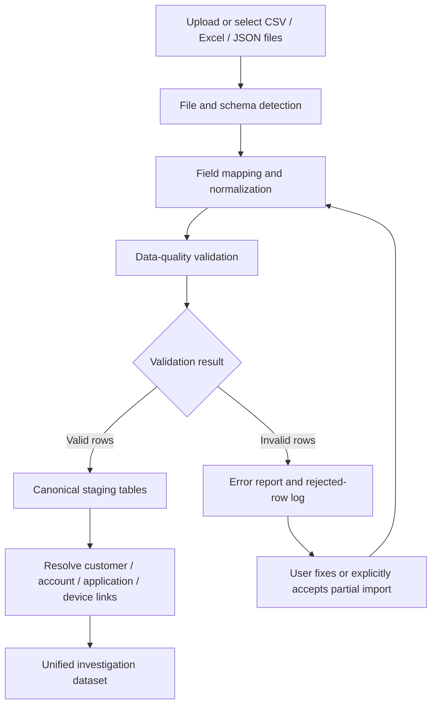
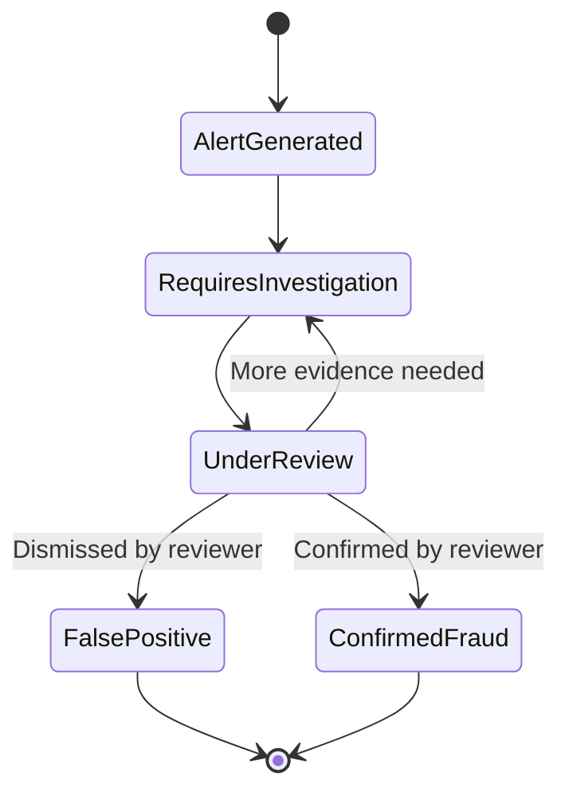
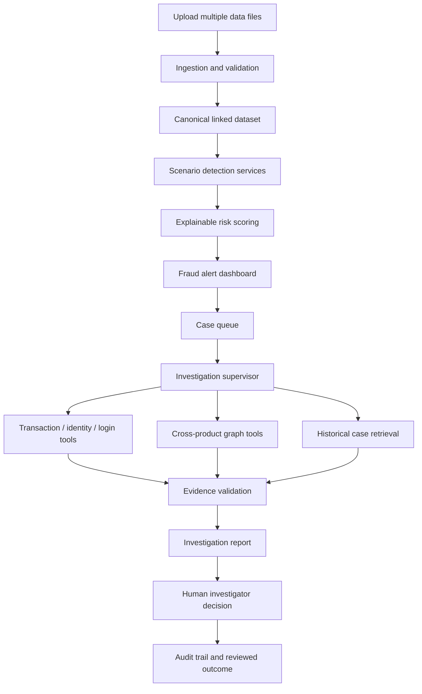
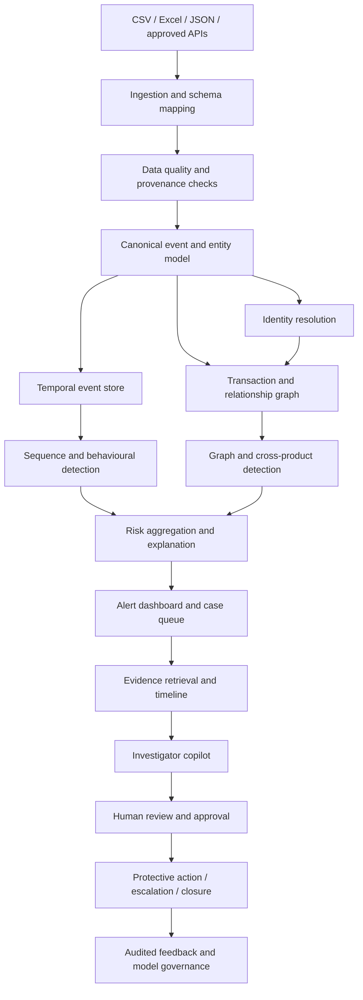

# Azentio Digital Fraud Investigation System

## Complete Hackathon Research, Product Gap Analysis, Solution Design, and Implementation Blueprint

**Prepared:** 31 October 2026\
**Purpose:** Consolidated working document for the Azentio AI hackathon
problem statement: *Digital Fraud Investigation System --- AI-assisted
detection, investigation and case intelligence.*

------------------------------------------------------------------------

# 1. Executive Summary

The recommended hackathon direction is to build an **Agentic Financial
Crime Investigation & Intelligence Platform** that complements Azentio's
existing financial-crime and banking products.

The core idea is not to build another standalone fraud classifier or
alert dashboard. Azentio already offers financial-crime capabilities,
especially through AMLOCK. The proposed system adds an intelligent
investigation layer that can:

1.  Receive an existing suspicious-activity alert.
2.  Plan and conduct a multi-step investigation using specialized AI
    agents.
3.  Query information across banking, customer, digital-channel, and
    historical-case systems.
4.  Reconstruct transaction paths and discover potentially connected
    entities.
5.  Compare current activity with previous investigations.
6.  Collect and validate source-backed evidence.
7.  Produce a structured investigation package for human review.

**Recommended positioning:**

> An agentic AI investigation layer that transforms suspicious
> financial-crime alerts into evidence-backed investigations by
> connecting fragmented financial data, discovering hidden
> relationships, correlating historical cases, and validating
> investigation findings.

The official Stage-1 challenge pack defines the MVP. The prototype must
cover the complete required journey: multi-source data ingestion, the
four minimum fraud scenarios, at least one additional scenario,
explainable risk scoring, a filterable alert dashboard, and a basic
fraud case queue. Money-mule investigation is a useful extension/demo
scenario, but it must not replace the required identity-fraud,
account-takeover, shared-device, suspicious-transfer, and cross-system
scenarios.

------------------------------------------------------------------------

# 2. Problem Statement and Opportunity

Financial institutions have increasingly sophisticated systems for
detecting suspicious transactions, monitoring customer behavior,
screening entities, and managing fraud alerts. However, complex
investigations can require analysts to gather information from multiple
systems, understand relationships between entities, reconstruct money
flows, review historical cases, and verify evidence.

A useful additional capability is a unified intelligence layer that
dynamically coordinates investigative activities, correlates evidence
across systems, discovers previously unidentified relationships, and
validates investigation findings.

The proposed platform should complement existing fraud detection, AML
monitoring, and case-management products rather than claim to replace
them.

## Official Stage-1 Challenge Pack: Source of Truth

The uploaded **ProblemStatement-Stage-1.pdf (5 pages)** is the
controlling source for the hackathon scope. This document has been
revised to align the solution with that brief.

The challenge is titled **Digital Fraud Investigation System** and
identifies these domains:

-   Digital lending.
-   Insurance.
-   Core banking.
-   Digital financial services.

Its focus areas are Fraud Detection, Risk Intelligence, Investigation,
Prevention, and Case Management.

The brief is not limited to AML transaction monitoring or money-mule
detection. It explicitly describes fraud across the digital customer
journey: identity verification, account creation, loan disbursement,
insurance claims, fund transfers, digital logins, and activity across
products.

### Stage-1 judging and implementation constraints

The challenge pack states:

-   Level 1 is a short 0--3 hour build challenge.
-   Judges value a working end-to-end core journey and observable
    behaviour, not architecture slides or unsupported AI claims.
-   Use synthetic or properly anonymised data only.
-   Do not use production credentials or collect live production data.
-   Organizers provide schemas, sample data, hidden tests, and sandbox
    API credentials where applicable.
-   The prototype is not certified for regulatory compliance.
-   AI model hosting or speech services are not provided. Teams must use
    their own model/API accounts and bear associated costs.

**Build implication:** Prioritize a working, testable application with
deterministic sample inputs and visible outputs. Do not spend the
Stage-1 window building a large production architecture or attempting
live integrations.

## Five central investigation questions

1.  **What happened?** Identify suspicious transactions, activities, and
    entities.
2.  **Why is it suspicious?** Explain the indicators and anomalies.
3.  **Who or what is connected?** Link accounts, customers, devices,
    IPs, merchants, beneficiaries, and cases.
4.  **What evidence supports the finding?** Collect and correlate source
    records.
5.  **What should happen next?** Recommend further investigative steps
    for an authorized human investigator.

------------------------------------------------------------------------

# 3. Azentio Product Landscape

Azentio focuses on Banking, Financial Services, Insurance (BFSI),
Capital Markets, and ERP.

The following products were identified as relevant to the problem.

## 3.1 AMLOCK

**Relevance: Very high.**

AMLOCK is Azentio's financial-crime detection and management platform.
Public product descriptions discuss capabilities such as:

-   AML and fraud transaction monitoring.
-   Rule-based detection and customer profiling.
-   Fraud and suspicious-activity identification.
-   KYC and onboarding-related capabilities.
-   Sanctions screening.
-   Risk scoring and alert prioritization.
-   Advanced analytics and machine learning.
-   False-positive reduction.
-   Entity matching and link analysis.
-   Customer 360-degree views.
-   Alert and case management.
-   Investigation workflows.
-   Regulatory reporting and audit trails.
-   Graphical analysis of relationships and hidden connections.
-   GenAI-based explanations for some screening decisions.

**Important:** Do not present basic transaction monitoring, risk
scoring, link analysis, case management, or AI explanations as entirely
missing from AMLOCK. Public product material already describes these
capabilities.

Potential extension areas include autonomous investigation planning,
cross-system reasoning, multi-hop temporal money-flow investigation,
cross-case intelligence, and independent evidence validation.

## 3.2 iMAL

**Relevance: High.**

iMAL is Azentio's Islamic core banking platform. Public material
describes capabilities including:

-   Customer and account management.
-   Payments and transfers.
-   Financing and lending.
-   Treasury and banking operations.
-   KYC.
-   AML/CFT.
-   Customer profiling.
-   Login fraud detection.
-   Analytics and data warehousing.

**Potential extension:** An investigation layer that can use authorized
iMAL and digital-channel data together with AMLOCK alerts and other
evidence sources.

## 3.3 Premia

**Relevance: Medium to high, especially for insurance fraud.**

Premia is an insurance administration platform. Public product material
describes:

-   Policy administration.
-   Claims processing.
-   Underwriting.
-   Claims automation.
-   OCR and document processing.
-   Fraud scoring.
-   Historical pattern analysis.
-   Audit and operational workflows.

**Potential extension:** Multimodal investigation that correlates
claims, documents, policyholders, repair providers, hospitals, bank
accounts, and historical claims.

## 3.4 Capital Markets and Wealth Products

Azentio's portfolio includes fund, wealth, and capital-market-related
solutions.

**Potential extension:** Investigation of suspicious trading patterns,
related entities, fund flows, and potentially connected counterparties.
This is a broader future direction rather than the recommended first
hackathon use case.

## 3.5 ERP

Azentio also offers ERP capabilities across enterprise finance and
operations.

**Potential extension:** Investigation of suspicious procurement, vendor
relationships, invoice manipulation, duplicate payments, and
employee/vendor connections. This is not the primary target for the
initial prototype.

------------------------------------------------------------------------

# 4. Existing Capabilities vs. Proposed Extensions

This distinction is essential.

Public product documentation indicates that Azentio already provides
substantial financial-crime functionality. Public documentation does
**not** reveal every internal limitation, customer complaint, unfinished
roadmap item, or production deployment detail.

Therefore, the following analysis distinguishes:

-   **Existing capability:** Described in public product material.
-   **Potential gap/opportunity:** A useful extension beyond the
    publicly described capability depth.
-   **Unverified limitation:** Cannot be claimed as a confirmed product
    deficiency without internal validation.

## 4.1 Existing AMLOCK baseline

  Capability                 Publicly described existing capability
  -------------------------- -------------------------------------------------
  Transaction monitoring     Real-time and/or offline monitoring
  Fraud detection            Rules, profiling, analytics
  False-positive reduction   ML-based approaches
  Sanctions screening        Watchlist screening
  KYC                        Onboarding and customer risk profiling
  Entity resolution          Matching records across names and data sources
  Link analysis              Static and transactional relationship analysis
  Case management            Alert and case workflows
  Investigation              Customer 360 and centralized case information
  Regulatory reporting       Reporting and audit trails
  Advanced analytics         Clustering, outlier and hidden-pattern analysis
  Explainability             GenAI explanations for certain decisions

**Implication:** A basic fraud classifier, graph visualization, alert
summary chatbot, or report generator would have substantial overlap with
existing product functionality.

## 4.2 Eight opportunity areas

### Opportunity 1: Autonomous end-to-end investigation

**Existing baseline:** AMLOCK publicly describes alert prioritization,
case management, investigation workflows, customer 360, documentation,
and AI-assisted analysis.

**Potential extension:** An investigation planner that dynamically
decides what to investigate next based on evidence found in previous
steps.

Example workflow:

1.  Receive an alert for Account A102.
2.  Identify missing information.
3.  Retrieve account and transaction history.
4.  Identify new beneficiaries.
5.  Investigate beneficiary relationships.
6.  Examine devices and IP addresses, if authorized data is available.
7.  Trace onward transfers.
8.  Search relevant historical cases.
9.  Validate the evidence.
10. Produce an investigation package.

The agent should replan when new evidence appears. For example, if a
common device is discovered, it should investigate that device's other
account relationships.

**Proposed build:** Autonomous Investigation Planner and Orchestrator.

**Qualification:** Public documentation does not prove that AMLOCK lacks
all agentic capabilities. This is a proposed capability expansion, not a
confirmed defect.

### Opportunity 2: Cross-system investigation and unified intelligence

**Existing baseline:** AMLOCK integrates with banking systems. iMAL
provides core-banking and related operational data. Azentio has
published a banking AML integration case involving more than 20 internal
banking systems.

**Potential extension:** A common semantic intelligence layer that lets
investigation agents reason across multiple systems and retrieve
relevant evidence without requiring an analyst to manually navigate each
system.

Potential sources:

  Source                  Potential information
  ----------------------- -----------------------------------------------
  AMLOCK                  Alerts, cases, risk indicators
  iMAL                    Customers, accounts, transfers
  Digital banking         Login and session activity
  Mobile banking          Device and app activity
  CRM                     Customer information
  KYC systems             Identity and ownership evidence
  Historical case store   Previous investigations and outcomes
  External sources        Authorized watchlists and threat intelligence

**Proposed build:** Unified Financial Intelligence Layer, including
entity resolution, semantic schema mapping, query planning, provenance,
and cross-system investigation tools.

**Qualification:** Existing integration and centralized views are
documented. A single autonomous reasoning layer across all these systems
is not established by the public material reviewed.

### Opportunity 3: Advanced multi-hop fraud network investigation

**Existing baseline:** AMLOCK already advertises graphical link
analysis, static and transactional links, hidden-connection detection,
clustering, and network analysis.

**Potential extension:** Agents that actively explore temporal
transaction paths and investigate multi-hop relationships.

Example:

-   Account A receives money from 12 accounts.
-   A transfers funds to B and C.
-   B and C transfer funds to D.
-   A, B, and C share a device.
-   D is linked to a separate historical case.

The system should:

1.  Reconstruct paths and transaction sequences.
2.  Calculate the flow of funds.
3.  Identify common devices, IPs, and counterparties.
4.  Analyze timing and velocity.
5.  Compare patterns with historical cases.
6.  Explain which links are verified and which are inferred.

**Proposed build:** Temporal Fraud Network Investigation Agent.

The differentiator is not drawing a graph. It is intelligently
discovering, investigating, and explaining source-supported paths.

### Opportunity 4: Cross-case intelligence and institutional memory

**Existing baseline:** AMLOCK publicly describes historical data, fraud
registers, case management, and analytical capabilities.

**Potential extension:** A system that discovers relationships between
apparently unrelated cases.

Example:

-   Case 101 involves phishing.
-   Case 205 involves a suspicious UPI transfer.
-   Case 311 involves a suspected mule account.

The cases may share a device fingerprint, beneficiary, phone number,
merchant, or IP address.

The system should identify the potential connection, retrieve the
supporting records, and distinguish confirmed relationships from
hypotheses.

**Proposed build:** Cross-Case Intelligence Agent.

Technical components:

-   Historical case repository.
-   Vector search.
-   Entity resolution.
-   Graph-based cross-case matching.
-   Similarity search.
-   Pattern clustering.
-   Investigator outcome feedback.

### Opportunity 5: Evidence verification and investigation QA

**Existing baseline:** AMLOCK describes documentation, audit trails, and
explainability.

**Potential extension:** An independent agent that challenges and
verifies the factual correctness and completeness of investigation
conclusions.

Example claim:

> Account A102 is potentially involved in a coordinated money-mule
> network.

The Evidence Validator asks:

-   Is there a transaction record supporting the claim?
-   Is account ownership verified?
-   Are timestamps consistent?
-   Does a shared device prove common ownership, or only shared access?
-   Are there alternative explanations?
-   Is the evidence sufficient?
-   What information is missing?

Suggested finding categories:

  Category            Meaning
  ------------------- ----------------------------------------
  Verified fact       Directly supported by source records
  Strong indication   Multiple supporting signals
  Hypothesis          Plausible but unconfirmed
  Contradiction       Evidence conflicts with the hypothesis
  Missing evidence    Further information is required

**Proposed build:** Evidence Integrity and Investigation QA Agent.

### Opportunity 6: Adaptive fraud detection and feedback learning

**Existing baseline:** AMLOCK already describes ML-driven false-positive
reduction, clustering, and behavioral analysis.

**Potential extension:** A controlled feedback loop that uses
investigator outcomes to evaluate and improve detection and
investigation strategies.

Workflow:

1.  Detection system flags an account.
2.  Investigator reviews the case.
3.  Investigator labels the outcome: genuine, false positive, or
    inconclusive.
4.  Reasons and evidence are recorded.
5.  Analytics identify useful and unhelpful signals.
6.  Model performance is evaluated.
7.  Rule or model changes are proposed, tested, and approved before
    deployment.

**Proposed build:** Fraud Intelligence Feedback Loop.

It should support:

-   Feedback-driven model evaluation.
-   Scenario performance analysis.
-   False-positive root-cause analysis.
-   Drift monitoring.
-   Rule recommendations.
-   Human approval before production changes.

### Opportunity 7: Multimodal fraud investigation

**Existing baseline:** Premia describes OCR, document capture, fraud
scoring, and historical pattern analysis. AMLOCK also has trade-based
AML capabilities.

**Potential extension:** A single investigation workflow that correlates
unstructured documents with structured financial records.

Trade-based example:

-   Invoice declares goods worth \$100,000.
-   Payment records show \$180,000.
-   Shipment documents indicate a different quantity.
-   The exporter is linked to previously investigated entities.

The system correlates the documents and transactions, identifies
discrepancies, and creates a source-backed investigation.

Insurance example:

-   Claim forms.
-   Medical bills.
-   Repair invoices.
-   Policy details.
-   Historical claims.
-   Payment beneficiaries.

**Proposed build:** Multimodal Financial Forensics Agent.

Technical components include OCR, document extraction, structured-data
matching, entity resolution, and evidence correlation.

### Opportunity 8: Investigation prioritization by potential impact

**Existing baseline:** AMLOCK describes risk scoring, alert
prioritization, and analytics.

**Potential extension:** A complementary investigation-priority
mechanism that considers the potential importance of an entire network
or case, not only the risk score of one alert.

Example:

  Case       Alert risk Additional intelligence
  -------- ------------ ---------------------------------
  Case A             92 Isolated suspicious transaction
  Case B             82 Connected to 15 accounts
  Case C             75 Connected to 3 historical cases

Case C may deserve earlier investigation if it could expose a wider
operation.

**Proposed build:** Investigation Priority Intelligence Agent.

Potential inputs:

-   Potential financial exposure.
-   Number of connected entities.
-   Velocity of suspicious activity.
-   Historical case connections.
-   Evidence availability.
-   Investigation urgency.
-   Potential ongoing victim impact.

This should complement, not replace, regulatory risk scoring.

------------------------------------------------------------------------

# 5. Five Hackathon Concepts

## Concept 1: Agentic Financial Crime Investigation Copilot

**Recommended first choice.**

An AI layer that receives an existing AMLOCK alert and autonomously
investigates it.

Agents:

-   Alert Triage Agent.
-   Investigation Planner Agent.
-   Transaction Analysis Agent.
-   Graph Intelligence Agent.
-   Evidence Validation Agent.
-   Case Reporting Agent.

Demo: Submit an alert ID. The system investigates the account, traces
funds, discovers related entities, finds supporting evidence, and
prepares an investigator-ready case.

Why it fits: It extends existing Azentio financial-crime capabilities
rather than competing with them.

## Concept 2: Autonomous Mule Account and Fraud Network Discovery

Identify coordinated financial-crime networks across accounts,
customers, devices, IPs, beneficiaries, and transactions.

Agents:

-   Mule Detection Agent.
-   Transaction Flow Agent.
-   Entity Resolution Agent.
-   Network Intelligence Agent.
-   Investigation Agent.

Demo: Discover a planted network of potentially connected accounts,
trace the flow of funds, and identify common infrastructure.

Why it fits: It extends transaction-level monitoring into multi-entity
network investigation.

## Concept 3: Trade-Based Money Laundering Investigation Agent

Investigate suspicious international trade transactions by correlating:

-   Commercial invoices.
-   Purchase orders.
-   Shipping documents.
-   Import/export records.
-   Payment transactions.
-   Company relationships.

Agents:

-   Document Extraction Agent.
-   Invoice Analysis Agent.
-   Payment Matching Agent.
-   Trade Pattern Detection Agent.
-   Investigation Agent.

Demo: Two invoices contain different declared values for the same
shipment. The system identifies the discrepancy, retrieves linked
transactions, and creates an investigation.

## Concept 4: Insurance Fraud Investigation Agent

Investigate suspicious insurance claims by connecting:

-   Policyholders.
-   Claims.
-   Vehicles.
-   Hospitals or garages.
-   Surveyors.
-   Bank accounts.
-   Previous claims.

Agents:

-   Claims Anomaly Agent.
-   Document Verification Agent.
-   Duplicate Claim Detection Agent.
-   Relationship Discovery Agent.
-   Investigation Report Agent.

Demo: Discover multiple claims associated with the same bank account,
phone number, repair shop, and suspicious supporting documents.

## Concept 5: Cross-Case Financial Crime Intelligence Agent

Investigate whether multiple apparently unrelated cases are connected.

Agents:

-   Case Retrieval Agent.
-   Semantic Search Agent.
-   Entity Matching Agent.
-   Pattern Discovery Agent.
-   Intelligence Summary Agent.

Demo: Three cases have different account numbers but share a device,
beneficiary, or business entity.

------------------------------------------------------------------------

# 6. Recommended Final Solution

## Name

**AFCII --- Azentio Financial Crime Intelligence & Investigation**

Alternative shorter name: **FraudIntel AI**.

## Product proposition

An agentic AI investigation layer that transforms existing
financial-crime alerts into autonomous, evidence-backed investigations
by connecting fragmented financial data, discovering hidden
relationships, correlating historical cases, and validating
investigation findings.

## Five core modules

### 1. Investigation Orchestrator

-   Receives an existing alert.
-   Creates an investigation plan.
-   Delegates work to specialist agents.
-   Tracks evidence and outstanding tasks.
-   Replans when new information is found.
-   Requests human input where required.

### 2. Unified Financial Intelligence Layer

-   Connects authorized data sources.
-   Resolves common business concepts.
-   Maps source schemas.
-   Supports natural-language investigation queries.
-   Tracks data provenance.
-   Resolves entities across systems.

### 3. Advanced Fraud Network Intelligence

-   Reconstructs temporal transaction paths.
-   Identifies multi-hop fund movement.
-   Finds shared devices and IPs.
-   Connects beneficiaries and counterparties.
-   Compares current networks with historical cases.
-   Explains source-supported relationships.

### 4. Evidence Integrity Engine

-   Validates agent claims against source records.
-   Identifies missing evidence.
-   Finds contradictions.
-   Separates facts from hypotheses.
-   Records source, timestamp, query, and agent provenance.

### 5. Cross-Case Intelligence

-   Retrieves similar historical cases.
-   Identifies shared entities.
-   Discovers repeated patterns.
-   Uses reviewed case outcomes as institutional knowledge.
-   Supports investigator feedback.

------------------------------------------------------------------------

# 7. Proposed End-to-End Architecture

``` text
                 EXISTING AZENTIO SYSTEMS
        AMLOCK | iMAL | Premia | Banking Systems
                         |
                  APIs / Events / Connectors
                         |
             UNIFIED FINANCIAL INTELLIGENCE
                         |
          +--------------+----------------+
          |              |                |
     Semantic Layer  Analytics Engine  Data Layer
          |              |                |
     Fraud Ontology   ML / Anomaly     PostgreSQL
     Schema Mapping   Detection        DuckDB
     NL2SQL           Risk Analysis    Neo4j
                                      Vector DB
          |              |                |
          +--------------+----------------+
                         |
              INVESTIGATION ORCHESTRATOR
                    (Supervisor)
                         |
       +-----------------+------------------+
       |                 |                  |
  Investigation     Network Agent      Cross-Case
     Planner                            Intelligence
       |                 |                  |
       +-----------------+------------------+
                         |
                 EVIDENCE VALIDATOR
                         |
                  CASE INTELLIGENCE
                         |
               HUMAN INVESTIGATOR REVIEW
```

## Agent roles

  Agent                   Responsibility
  ----------------------- --------------------------------------------------
  Supervisor Agent        Coordinates the investigation
  Alert Triage Agent      Interprets the initial alert
  Investigation Planner   Plans and replans investigation steps
  Transaction Agent       Retrieves and analyzes transactions
  Semantic Query Agent    Maps questions to validated data queries
  Graph Agent             Finds entity relationships and transaction paths
  Intelligence Agent      Searches historical cases
  Evidence Agent          Collects and verifies evidence
  Case Agent              Prepares the investigation package
  Compliance Agent        Checks policy and workflow requirements

------------------------------------------------------------------------

# 8. Recommended Technology Stack

  Layer                 Suggested technology
  --------------------- ----------------------------
  Frontend              React + Tailwind CSS
  Backend               FastAPI
  Agent orchestration   LangGraph
  LLM                   GPT, Claude, or Qwen
  Relational database   PostgreSQL
  Graph database        Neo4j
  Analytics             DuckDB + Pandas
  ML detection          XGBoost + Isolation Forest
  Vector search         Qdrant or pgvector
  Event streaming       Redpanda
  Document processing   OCR + document extraction
  Graph visualization   React Flow
  Charts                Plotly

For a hackathon prototype, do not deploy everything unnecessarily. A
practical stack is:

-   FastAPI.
-   LangGraph.
-   PostgreSQL.
-   DuckDB.
-   Neo4j.
-   One suitable LLM.
-   React dashboard.

------------------------------------------------------------------------

# 9. How to Reuse Nora's Existing Technology

The existing Nora work can be a significant engineering advantage.

  ---------------------------------------------------------------------
  Nora capability                    Role in AFCII
  ---------------------------------- ----------------------------------
  NL2SQL engine                      Query transaction and banking
                                     databases

  Semantic layer                     Map financial-crime concepts to
                                     actual schemas

  Business Rules Graph               Represent AML policies and fraud
                                     indicators

  Database Schema Graph              Connect source-system schemas

  Knowledge Graph                    Model accounts, devices,
                                     beneficiaries, transactions, and
                                     cases

  EDA agent                          Analyze behavioral anomalies

  Data Science agent                 Run fraud detection and
                                     statistical analysis

  Data ingestion                     Normalize and prepare information
                                     from different sources
  ---------------------------------------------------------------------

## Recommended extension: Financial Crime Ontology

Build a domain ontology containing:

-   Customer.
-   Account.
-   Beneficiary.
-   Transaction.
-   Device.
-   IP address.
-   Merchant.
-   Fraud indicator.
-   AML typology.
-   Investigation case.
-   Evidence.
-   Risk relationship.
-   Complaint.
-   Login session.
-   Payment instrument.

Example investigator query:

> Find all suspicious accounts connected to beneficiaries involved in
> previous confirmed fraud cases.

Proposed execution:

1.  Resolve the business concepts using the financial-crime ontology.
2.  Identify relevant database tables through the semantic layer.
3.  Generate and validate the required queries.
4.  Retrieve source records.
5.  Build entity and transaction relationships.
6.  Search historical cases.
7.  Trigger further investigation where appropriate.
8.  Return evidence-backed findings.

This combines deterministic retrieval, semantic mapping, graph
reasoning, analytics, and agentic AI.

------------------------------------------------------------------------

# 10. Recommended Hackathon MVP

## Use case: Autonomous Money-Mule Investigation

Do not attempt to implement every fraud category. Build one complete,
convincing investigation workflow.

### Scenario

A suspected fraudster uses multiple accounts to receive money from
victims and transfer funds through intermediary accounts.

### Step 1: Generate or prepare synthetic banking data

Create datasets with interconnected records.

  Dataset        Example fields
  -------------- --------------------------------------------------
  Customers      customer_id, name, phone, KYC
  Accounts       account_id, customer_id, opening_date
  Transactions   txn_id, sender, receiver, amount, timestamp
  Devices        device_id, account_id, IP
  Login logs     account_id, IP, device_id, timestamp
  Complaints     complaint_id, victim_account, amount, fraud_type

Start with approximately 1,000--10,000 synthetic transactions and
several planted fraud scenarios.

Potential public datasets:

-   PaySim mobile money dataset:
    https://www.kaggle.com/datasets/ealaxi/paysim1
-   Credit Card Fraud Detection:
    https://www.kaggle.com/datasets/mlg-ulb/creditcardfraud

PaySim is useful for synthetic mobile-money scenarios. Device, IP, KYC,
and complaint data may need to be generated separately.

### Step 2: Detect suspicious activity

Build a hybrid scoring engine using rules and ML.

Illustrative scoring formula:

``` python
risk_score = (
    0.25 * transaction_anomaly_score +
    0.20 * velocity_score +
    0.20 * network_risk_score +
    0.15 * device_risk_score +
    0.20 * historical_pattern_score
)
```

These weights are examples only. Calibrate them against planted fraud
labels and evaluate the results.

### Step 3: Build the graph

Load accounts, customers, devices, IPs, and transactions into Neo4j.

Example Cypher:

``` cypher
MATCH (a:Account)-[t:TRANSFERRED_TO]->(b:Account)
WITH a, b, count(t) AS tx_count,
     sum(t.amount) AS total_amount
WHERE tx_count > 3
RETURN a, b, tx_count, total_amount
ORDER BY total_amount DESC
```

Extend the graph with time-aware relationships, shared devices, shared
IPs, and historical cases.

### Step 4: Trigger an autonomous investigation

Suppose Account A102 is flagged.

1.  Detection Agent explains the triggering indicators.
2.  Supervisor creates an investigation plan.
3.  Transaction Agent retrieves transaction history.
4.  Graph Agent identifies linked accounts and devices.
5.  Intelligence Agent searches historical cases.
6.  Evidence Agent verifies supporting records.
7.  Case Agent prepares the report.

The investigator can ask additional questions while the investigation is
in progress.

### Step 5: Generate the case package

The case should include:

-   Case ID.
-   Potential fraud classification.
-   Risk score and supporting factors.
-   Accounts and entities involved.
-   Transaction flow visualization.
-   Shared devices and IP addresses.
-   Evidence timeline.
-   Potential financial exposure.
-   Missing evidence.
-   Recommended next investigative steps.

All findings should be traceable to source records.

------------------------------------------------------------------------

# 11. Example Investigation State

The supervisor can maintain a shared investigation state:

``` python
investigation_state = {
    "case_id": "CASE-001",
    "trigger": {},
    "entities": [],
    "suspicious_transactions": [],
    "graph_relationships": [],
    "fraud_indicators": [],
    "investigation_hypotheses": [],
    "evidence": [],
    "missing_information": [],
    "risk_score": None,
    "recommended_actions": [],
    "case_report": None
}
```

Agents should update this state through validated tools and structured
outputs.

## Example investigation tools

``` python
get_transaction_history(account_id)
get_account_details(account_id)
get_linked_accounts(account_id)
get_device_activity(device_id)
get_ip_activity(ip_address)
search_previous_cases(pattern)
get_kyc_details(customer_id)
get_merchant_details(merchant_id)
```

The LLM should coordinate tool use, not invent source records.

------------------------------------------------------------------------

# 12. Evidence-Backed Reasoning

This should be one of the strongest differentiators.

Every important investigation claim should have an evidence reference.

  ---------------------------------------------------------------------
  Agent claim                        Evidence reference
  ---------------------------------- ----------------------------------
  Account A102 has unusual           TXN-102, TXN-105, TXN-108
  transaction velocity               

  Three accounts share a device      DEV-001

  Funds were transferred to          TXN-201, TXN-202
  intermediary accounts              

  Account has a historical complaint CMP-011
  ---------------------------------------------------------------------

Maintain:

-   Evidence source.
-   Record ID.
-   Timestamp.
-   Agent that collected it.
-   Query or tool used.
-   Confidence or certainty classification.
-   Whether the claim is verified or inferred.

The Evidence Validator should challenge the other agents' conclusions.

A shared device alone should not be treated as proof of common ownership
or fraud. The system must account for alternative explanations.

------------------------------------------------------------------------

# 13. Interactive Investigation Copilot

The frontend should not just display static reports. It should allow an
investigator to interact with the investigation.

Example questions:

-   Show the complete money trail from the victim account.
-   Find all accounts connected to this device.
-   Why was this transaction flagged?
-   Compare this case with previous fraud incidents.
-   Which evidence is still missing?
-   Generate an investigation report.
-   Show the top five suspicious account networks.
-   Explain why these accounts are considered connected.
-   What alternative explanations should be considered?

The copilot should show its tool activity and cite source records for
its findings.

------------------------------------------------------------------------

# 14. Example Dashboard Layout

The Investigation Command Center can include:

## Overview

-   Active investigations.
-   High-priority alerts.
-   Potential financial exposure.
-   Cases awaiting human review.

## Investigation workspace

-   Alert and customer information.
-   Transaction timeline.
-   Account relationship graph.
-   Shared device and IP indicators.
-   Historical case connections.
-   Agent execution status.

## Evidence panel

-   Source records.
-   Supporting and contradicting evidence.
-   Missing information.
-   Claim validation status.

## Case report

-   Investigation summary.
-   Potential fraud typology.
-   Entities involved.
-   Transaction trails.
-   Evidence.
-   Uncertainties.
-   Recommended next investigative steps.

------------------------------------------------------------------------

# 15. Development Roadmap

  Phase   Deliverable
  ------- ------------------------------------------
  1       Synthetic data generation and database
  2       Fraud detection and risk scoring
  3       Graph construction and network discovery
  4       Multi-agent investigation orchestration
  5       Evidence collection and validation
  6       Case report generation
  7       Dashboard and conversational copilot
  8       Demo, evaluation, and presentation

For a short hackathon, prioritize one end-to-end investigation workflow
over implementing many shallow agents.

------------------------------------------------------------------------

# 16. Evaluation Metrics

Measure actual performance rather than claiming that AI automatically
improves fraud detection.

  ---------------------------------------------------------------------
  Metric                             Measurement
  ---------------------------------- ----------------------------------
  Investigation time                 Time to complete a defined
                                     investigation

  Evidence coverage                  Percentage of required evidence
                                     collected

  Investigation accuracy             Correctness against known ground
                                     truth

  Network discovery                  Planted relationships successfully
                                     discovered

  Cross-case detection               Correct links between related
                                     historical cases

  Unsupported conclusions            Number of claims lacking evidence

  Agent efficiency                   Tool calls and cost per
                                     investigation

  False-positive impact              Change in unnecessary
                                     investigation workload

  Human review effort                Time and actions required from the
                                     investigator
  ---------------------------------------------------------------------

Build a synthetic dataset with known fraud networks so the prototype can
be evaluated against ground truth.

------------------------------------------------------------------------

# 17. What Not to Build

Avoid spending the hackathon on features that substantially duplicate
existing product capabilities.

  ---------------------------------------------------------------------
  Avoid presenting as the main       Why
  innovation                         
  ---------------------------------- ----------------------------------
  Basic transaction fraud classifier AMLOCK already has fraud detection

  Basic anomaly detection            Existing analytics and ML
                                     capabilities

  Simple graph visualization         AMLOCK already has link analysis

  Basic alert dashboard              Existing alert and case management

  Simple case-summary chatbot        Existing investigation and GenAI
                                     capabilities

  Basic risk score explanation       Existing explainability features

  Simple PDF report generator        Documentation and reporting
                                     already exist
  ---------------------------------------------------------------------

Instead, build the intelligence and orchestration layer that connects
these capabilities into a dynamic investigation.

------------------------------------------------------------------------

# 18. Recommended Priority Ranking

  -----------------------------------------------------------------------
  Opportunity       Existing overlap  Additional value  Hackathon
                                                        priority
  ----------------- ----------------- ----------------- -----------------
  Autonomous        Medium            Very high         1
  investigation                                         

  Cross-system      Medium            Very high         2
  semantic                                              
  intelligence                                          

  Temporal          High              Very high         3
  multi-hop network                                     
  investigation                                         

  Cross-case        Medium            Very high         4
  intelligence                                          

  Evidence          Medium            Very high         5
  validation                                            

  Adaptive feedback High              High              Later
  loop                                                  

  Multimodal        Medium            High              Alternative use
  forensics                                             case

  Investigation     High              Medium            Later
  prioritization                                        
  -----------------------------------------------------------------------

Recommended combination:

**Build the Autonomous Investigation Orchestrator as the central
innovation, supported by the semantic intelligence layer, network
intelligence, cross-case retrieval, and evidence validation.**

------------------------------------------------------------------------

# 19. Final Hackathon Problem Statement

## Digital Fraud Investigation System --- Agentic Financial Crime Investigation & Intelligence

### Problem Statement

Financial institutions have increasingly sophisticated systems for
detecting suspicious transactions, monitoring customer behavior,
screening entities, and managing fraud alerts. However, investigating
complex financial crime remains challenging because relevant information
is distributed across multiple banking systems, transaction databases,
customer records, digital channels, and historical investigation cases.

Although existing platforms provide transaction monitoring, risk
scoring, graph-based link analysis, and case management, investigators
can still benefit from a unified intelligence layer that dynamically
coordinates investigative activities, correlates evidence across
systems, discovers previously unidentified relationships, and validates
investigation findings.

### Proposed Solution

Develop an Agentic AI-powered Financial Crime Investigation System that
extends existing fraud detection and case management platforms through
autonomous, evidence-driven investigation capabilities.

The system will introduce:

1.  **Autonomous Investigation Orchestration:** AI agents dynamically
    plan and execute multi-step investigations based on suspicious
    alerts and newly discovered evidence.
2.  **Unified Financial Intelligence:** A semantic intelligence layer
    connects banking transactions, customer profiles, digital banking
    activity, KYC records, and historical cases across multiple systems.
3.  **Advanced Fraud Network Discovery:** Temporal graph intelligence
    reconstructs money flows, identifies interconnected accounts,
    discovers shared infrastructure, and correlates potentially
    coordinated fraud networks.
4.  **Evidence Validation and Integrity:** Independent agents verify
    investigation findings against source records, identify
    contradictory information, and highlight missing evidence.
5.  **Cross-Case Intelligence:** Historical investigations become
    reusable institutional knowledge, enabling the discovery of
    connections between apparently unrelated fraud incidents.

### Expected Outcome

Transform traditional alert-driven fraud investigation into an
intelligent, coordinated, evidence-backed investigation process that
reduces repetitive manual analysis, improves investigation efficiency,
strengthens explainability, and enables investigators to identify
complex financial-crime patterns across interconnected systems.

The solution is designed to complement existing financial-crime
platforms rather than replace their transaction monitoring, compliance,
or case-management capabilities.

------------------------------------------------------------------------

# 20. Sources and Research References

The following links were identified during the product research. Product
capabilities should be revalidated against current official
documentation and with Azentio's product or engineering teams before
making claims about deficiencies.

## Azentio and AMLOCK

-   Azentio website: https://www.azentio.com/
-   AMLOCK product overview: https://www.azentio.com/
-   AMLOCK Investigation and Case Management: Refer to the AMLOCK
    product pages on Azentio's website.
-   AMLOCK Fraud Detection: Refer to Azentio's AMLOCK Fraud Detection
    product material.
-   AMLOCK Advanced Analytics: Refer to Azentio's official AMLOCK
    material.
-   AMLOCK Trade-Based Anti-Money Laundering: Refer to Azentio's
    official product material.
-   iMAL: Refer to Azentio's official Islamic core banking product
    pages.
-   Premia: Refer to Azentio's official insurance product pages.

## Public datasets

-   PaySim: https://www.kaggle.com/datasets/ealaxi/paysim1
-   Credit Card Fraud Detection:
    https://www.kaggle.com/datasets/mlg-ulb/creditcardfraud

## Important research qualification

The product-gap analysis is based on publicly described capabilities and
potential extensions. It does not establish that Azentio has failed to
implement any proposed capability internally or that no customer
deployment already provides it.

Before presenting a gap as a confirmed deficiency, validate it with
Azentio's hackathon brief, product team, engineering team, or customer
requirements.

------------------------------------------------------------------------

# 21. Final Recommendation

Build a working prototype of **Azentio Autonomous Financial Crime
Investigation Intelligence (AFCII)** around a suspicious money-mule
network.

The demonstration should show:

1.  An existing-style fraud alert enters the system.
2.  The supervisor agent creates an investigation plan.
3.  The semantic layer retrieves relevant banking data.
4.  The transaction agent reconstructs the money flow.
5.  The graph agent discovers connected accounts and shared
    infrastructure.
6.  The cross-case agent finds historical links.
7.  The evidence validator checks every important conclusion.
8.  The case agent prepares a complete investigation package.
9.  A human investigator reviews and authorizes the next action.

The strongest product story is:

**From detecting suspicious activity to autonomously investigating
financial crime with evidence-backed intelligence.**

The strongest technical story is:

**Nora's semantic intelligence, NL2SQL, ontology, knowledge graph, and
analytics capabilities become the foundation of a multi-agent
financial-crime investigation platform.**

The strongest business story is:

**Azentio's existing financial-crime products remain the systems of
detection and record, while AFCII adds an intelligent investigation
layer that can connect information, pursue leads, validate evidence, and
help investigators work more efficiently.**

------------------------------------------------------------------------

# 22. Official Stage-1 Requirements: Detailed Scope and Acceptance Checklist

This section is derived directly from the uploaded
*ProblemStatement-Stage-1.pdf*. It should be treated as the functional
acceptance checklist for the prototype.

## 22.1 Required data ingestion and integration

The application must allow users to upload or select data from multiple
financial and digital systems.

The challenge pack lists the following sample information:

-   Customer profiles.
-   Account identifiers.
-   Contact details.
-   Device and IP information.
-   Transaction history.
-   Login events and timestamps.
-   Sender and beneficiary details.
-   Insurance application information.
-   Loan application information.

Supported formats:

-   CSV.
-   Excel.
-   JSON.

The application should normalize records into a common structure so that
records can be linked through shared identifiers such as customer,
account, application, and device.

It must support multiple files and different formats. Data-quality
checks must be visible; invalid data must not be silently ignored.

### Recommended canonical data model

  -----------------------------------------------------------------------
  Entity                  Suggested key fields    Relationships
  ----------------------- ----------------------- -----------------------
  Customer                customer_id, name, DOB, Accounts, applications,
                          phone, email, address,  claims, devices
                          identity attributes     

  Account                 account_id,             Transactions,
                          customer_id,            beneficiaries, logins
                          product_type, status,   
                          opened_at               

  Application             application_id,         Loan/insurance
                          customer_id,            application, documents
                          product_type,           
                          submitted_at, status    

  Transaction             transaction_id,         Accounts, beneficiaries
                          sender_account,         
                          beneficiary_account,    
                          amount, currency,       
                          timestamp, channel      

  Login event             event_id, customer_id,  Customer, account,
                          account_id, timestamp,  device
                          success, IP, device_id, 
                          location                

  Device                  device_id, fingerprint, Customers, accounts,
                          first_seen, last_seen   sessions

  Beneficiary             beneficiary_id,         Customer, account,
                          account_or_wallet_id,   transfers
                          added_at                

  Identity document       document_id,            Customer, application
                          customer_id,            
                          document_type,          
                          extracted attributes,   
                          verification status     

  Loan application        loan_application_id,    Customer, application
                          customer_id,            
                          requested_amount,       
                          submitted_at, declared  
                          details                 

  Insurance claim         claim_id, policy_id,    Customer, policy,
                          customer_id, amount,    documents
                          incident_date,          
                          submitted_at            

  Address/contact         normalized_address,     Multiple customer
                          phone, email            profiles

  Case                    case_id, alert_id,      Evidence, alerts,
                          customer_id, category,  entities
                          risk, status,           
                          created_at              
  -----------------------------------------------------------------------

The canonical schema is a proposed implementation design, not a schema
supplied by Azentio. The team should adapt it to the organizers' actual
sample schema and hidden tests.

### Data ingestion workflow



**Must demonstrate:** file upload, format handling, field mapping,
validation errors, common identifiers, and successful linkage across
files.

## 22.2 Minimum fraud scenarios required by the brief

The Stage-1 pack names four minimum scenarios and requires at least one
additional fraud scenario beyond that catalogue.

### Scenario 1: Identity fraud and synthetic customer profiles

The brief describes fraudsters using stolen identity documents or
combining genuine and fabricated information to create fraudulent
customer profiles.

Required detection signals include:

-   Inconsistent identity attributes.
-   Repeated contact information.
-   Suspiciously similar customer profiles.
-   Multiple supposedly independent customers sharing devices, IP
    addresses, addresses, phone numbers, or digital identity attributes.
-   Coordinated applications or transactions.

**Important nuance:** The system must distinguish suspicious
coordination from legitimate shared infrastructure, such as family
members using a common phone.

**Recommended detection design:**

1.  Normalize names, phone numbers, email addresses, addresses, and
    identity attributes.
2.  Identify exact and fuzzy duplicate profiles.
3.  Detect repeated identifiers across customer applications.
4.  Link customers to shared devices, IPs, addresses, and contact
    details.
5.  Examine timing and downstream behavior.
6.  Assign a contextual risk score.
7.  Explain why the relationship is suspicious and what evidence
    supports it.

**Proposed agent:** Identity & Synthetic Profile Investigation Agent.

**Azentio product context:** Azentio publicly describes AMLOCK
KYC/onboarding capabilities, identity verification, entity resolution,
risk scoring, AI image screening, and ongoing due diligence. Its digital
onboarding offering describes document capture/validation, face
matching, and liveness detection. Therefore, do not claim that basic
identity verification or KYC is missing. The potential extension is
cross-profile and cross-product synthetic-identity investigation,
including contextual evaluation of shared attributes and coordination
over time.

### Scenario 2: Account takeover and suspicious login activity

The brief describes unauthorized account access using stolen
credentials, phishing, or compromised authentication mechanisms.

Signals explicitly named:

-   Repeated failed login attempts.
-   Unexpected device changes.
-   Unusual access locations.
-   Password resets followed by large transfers.
-   Changes to beneficiary information.
-   Login events correlated with device activity, location, password
    resets, beneficiary changes, and subsequent transactions.

**Recommended detection design:**

1.  Build a time-ordered event sequence for each customer/account.
2.  Detect bursts of failed logins.
3.  Identify a subsequent successful login.
4.  Detect a new or changed device.
5.  Identify unusual location or IP changes.
6.  Detect password reset or credential recovery events.
7.  Detect beneficiary creation or modification.
8.  Correlate the sequence with a high-value or unusual transfer.
9.  Score the full sequence, not each event independently.

**Example high-risk sequence:**

``` text
Repeated failed logins
        ↓
Successful login from a new device
        ↓
Password reset / recovery event
        ↓
New beneficiary added
        ↓
Large or unusual transfer
        ↓
High-priority account-takeover investigation alert
```

**Proposed agent:** Account Takeover & Session Behaviour Agent.

**Azentio product context:** Public iMAL functional material includes
Login Fraud Detection. AMLOCK describes multi-channel fraud monitoring,
behavioral profiling, rules, scores, and alerts. The opportunity is a
richer, end-to-end sequence correlation across authentication, device,
beneficiary, and transaction events, potentially across products. Do not
claim that Azentio has no login-fraud detection.

### Scenario 3: Cross-system and organized fraud

The brief says fraud patterns may become visible only when information
from lending, insurance, and core banking is correlated.

Required cross-system entities include:

-   Related customers.
-   Accounts.
-   Devices.
-   Applications.
-   Insurance claims.
-   Transactions.

The system should correlate activities across applications,
transactions, and claims to identify potentially organized fraud.

**Recommended detection design:**

1.  Ingest records from lending, insurance, core banking, and digital
    channels.
2.  Resolve common customer, account, application, contact, and device
    identifiers.
3.  Build a cross-product relationship graph.
4.  Identify repeated or coordinated entities and attributes.
5.  Correlate application submission, approval, disbursement, claim, and
    transaction timelines.
6.  Explain the cross-system relationships supporting the alert.

**Proposed agent:** Cross-Product Fraud Intelligence Agent.

**Azentio product context:** Azentio has products in core banking,
lending, insurance, and financial crime. Its public material describes
integration capabilities and cross-channel monitoring. The potential
extension is a shared investigation model that can reason across product
boundaries, rather than treating each product's signals as separate
alerts or records.

### Scenario 4: Suspicious transfers

The challenge pack specifically requires detection of:

-   Unusual transaction amounts.
-   Rapid transfers.
-   New beneficiaries.
-   Transactions inconsistent with a customer's normal history.

**Recommended detection design:**

-   Customer-specific amount and frequency baselines.
-   Transaction velocity windows.
-   New-beneficiary detection.
-   Rapid onward-transfer detection.
-   Unusual time/channel detection.
-   Relationship and device context.
-   Historical behavior comparison.

**Proposed agent:** Transaction Behaviour & Money-Flow Agent.

**Azentio product context:** AMLOCK publicly describes multi-channel
fraud monitoring, configurable rules, customer profiling, historical
behavior, real-time alerts, and transaction monitoring. The additional
value is combining these signals with identity, device, login,
application, and cross-product context in a single investigation.

### Scenario 5: At least one additional scenario is mandatory

The challenge pack explicitly asks participants to implement at least
one additional fraud scenario beyond the four listed scenarios. It gives
suspicious loan applications and duplicate insurance claims as examples.

Recommended additional scenario for the prototype:

**Duplicate and coordinated insurance-claim / loan-application fraud.**

Choose one that can be demonstrated reliably with the provided sample
data.

Option A --- Duplicate insurance claims:

-   Repeated claim details.
-   Reused documents or images.
-   Same incident details across different policies.
-   Shared claimant, bank account, phone, garage, hospital, or repair
    provider.
-   Suspicious timing and claim patterns.

Option B --- Suspicious loan applications:

-   Reused identity or contact details.
-   Similar or duplicated documents.
-   Multiple applications using shared devices.
-   Inconsistent declared information.
-   Coordinated applications across customer profiles.
-   Unusual changes immediately before approval or disbursement.

**Proposed agent:** Application & Claims Fraud Agent.

For a Stage-1 demo, choose one additional scenario and implement it
end-to-end rather than implementing both superficially.

------------------------------------------------------------------------

# 23. Required Risk Assessment, Alert Dashboard, and Case Queue

These are mandatory functional requirements, not optional future
features.

## 23.1 Explainable fraud risk assessment

Every detected suspicious activity must receive either:

-   A numeric risk score from 0--100; or
-   A Low / Medium / High category.

The score must consider multiple relevant indicators rather than one
threshold.

Example: a high-value transfer immediately after multiple failed login
attempts and a new-device login should receive a higher risk assessment
than the transfer alone.

### Suggested prototype scoring model

An illustrative composite score:

``` python
risk_score = (
    0.20 * identity_anomaly_score +
    0.20 * login_sequence_score +
    0.20 * transaction_anomaly_score +
    0.15 * shared_entity_network_score +
    0.15 * cross_product_activity_score +
    0.10 * historical_case_similarity_score
)
```

These are starting weights for a prototype, not validated production
parameters. Calibrate using the challenge dataset and ground-truth
labels. Avoid double-counting correlated signals.

Suggested presentation bands:

      Score Label      Suggested handling
  --------- ---------- ---------------------------
      0--29 Low        Monitor / retain context
     30--59 Medium     Review when appropriate
     60--79 High       Prioritized investigation
    80--100 Critical   Urgent human review

Thresholds must be configurable and evaluated against the sample data.

Every score should include a reason breakdown, such as:

-   New device login.
-   Multiple failed login attempts.
-   Password reset before transfer.
-   New beneficiary.
-   Unusual transaction amount.
-   Repeated contact details across profiles.
-   Cross-product entity link.

Do not let an LLM invent risk scores. Calculate scores using
deterministic rules or validated models; use the LLM to explain the
evidence and recommend investigative steps.

## 23.2 Fraud alert dashboard

The challenge pack requires a dashboard that displays:

-   Detected suspicious activities.
-   Flagged events.
-   Risk scores.
-   Reasons the events were flagged.
-   Supporting records.

Users must be able to filter by:

-   Customer.
-   Transaction.
-   Product.
-   Risk level.
-   Date.
-   Detection type.

Selecting an alert must display the underlying event, detection reasons,
and supporting records.

**Recommended dashboard layout:**

``` text
+--------------------------------------------------------------+
| Fraud Intelligence Dashboard                                 |
+--------------------------------------------------------------+
| Active Alerts | High Risk | Cases Open | Potential Exposure  |
+--------------------------------------------------------------+
| Filters: Customer | Transaction | Product | Risk | Date      |
+--------------------------------------------------------------+
| Alert ID | Customer | Product | Type | Score | Status        |
+--------------------------------------------------------------+
| Selected Alert                                               |
| - Triggering event                                           |
| - Risk score and factor breakdown                            |
| - Supporting source records                                  |
| - Related customer/account/device/application                |
| - Timeline and linked activity                               |
+--------------------------------------------------------------+
```

## 23.3 Basic fraud case queue

Every actionable fraud alert must be available in a case queue.

Each case should contain:

-   Unique case identifier.
-   Affected customer/account.
-   Suspected fraud category.
-   Risk level.
-   Supporting evidence.
-   Investigation status.

Required status examples:

-   Requires Investigation.
-   False Positive.
-   Confirmed Fraud.

The system must preserve the original alert even when an investigator
changes its classification. Keep an audit trail of status changes,
timestamps, and the reviewer.

**Recommended case lifecycle:**



------------------------------------------------------------------------

# 24. Revised Azentio Product-to-Challenge Mapping

This is the central product-gap analysis. It maps the official challenge
scenarios to Azentio's publicly described products and identifies the
most defensible future extensions.

**Interpretation key:**

-   **Documented:** Public Azentio material explicitly describes the
    capability.
-   **Partial / adjacent:** Related capability is described, but the
    exact end-to-end challenge workflow is not established by the
    material reviewed.
-   **Opportunity to extend:** A proposed future capability, not a
    verified product deficiency.
-   **Unverified:** Internal product information is needed to establish
    whether the capability already exists in a customer deployment or
    roadmap.

  -------------------------------------------------------------------------------------------
  Challenge          Relevant Azentio  Publicly documented    Proposed additional focus
  requirement        product(s)        baseline               
  ------------------ ----------------- ---------------------- -------------------------------
  Identity fraud /   AMLOCK KYC &      Identity verification, Cross-customer synthetic
  synthetic profiles Onboarding;       KYC, document checks,  identity detection across
                     Digital           liveness/face          applications, accounts,
                     Onboarding; iMAL  matching, entity       devices, addresses, and
                                       resolution, customer   products; contextual
                                       risk scoring           shared-attribute analysis

  Account takeover   iMAL; AMLOCK;     iMAL functional        Correlate failed logins,
                     digital banking   architecture lists     successful login, device
                                       Login Fraud Detection; change, location, password
                                       AMLOCK describes       reset, beneficiary change, and
                                       multi-channel fraud    subsequent transaction into one
                                       monitoring and         temporal investigation
                                       behavior profiling     

  Shared-device      AMLOCK; iMAL /    Device/channel data    Distinguish household/shared
  detection          digital channels  and behavioral/link    legitimate devices from
                                       analysis are relevant  coordinated account creation or
                                       to the existing        suspicious transaction behavior
                                       product ecosystem;     
                                       exact shared-device    
                                       family-versus-fraud    
                                       workflow is not        
                                       confirmed in reviewed  
                                       public material        

  Suspicious         AMLOCK Fraud      Multi-channel          Contextual transaction
  transfers          Detection /       transaction            investigation combining
                     Transaction       monitoring, rules,     identity, login, device,
                     Monitoring        profiling, scores,     beneficiary, customer baseline,
                                       historical behavior,   and downstream money movement
                                       real-time alerts       

  Cross-system       AMLOCK; iMAL;     Financial-crime        Cross-product entity graph and
  organized fraud    Azentio Lending;  monitoring, banking,   investigation context spanning
                     Premia            lending lifecycle,     lending applications, insurance
                                       insurance claims, APIs claims, core banking accounts,
                                       and integration        and digital activity
                                       capabilities           

  Additional         Azentio Lending;  Loan origination,      Detect coordinated
  loan-application   AMLOCK; Digital   eligibility/fraud/ID   applications, repeated
  fraud              Onboarding        checks in published    identities/documents/devices,
                                       lending overview,      inconsistent information, and
                                       onboarding and risk    suspicious
                                       capabilities           application-to-disbursement
                                                              sequences

  Additional         Premia Claim      OCR, claims workflow,  Cross-claim and cross-product
  insurance-claim    Automation;       fraud scoring,         entity investigation: claimant,
  fraud              AMLOCK            historical pattern     policy, bank account,
                                       checks, audit logs and documents, repair provider,
                                       APIs                   device, and related banking
                                                              activity

  Explainable risk   AMLOCK KYC, fraud Configurable rules, ML Unified reason codes and
  scoring            detection,        signals, risk scores,  evidence references across all
                     screening         explanations for       challenge scenarios and product
                                       certain screening      domains
                                       decisions              

  Alert dashboard    AMLOCK            Alert prioritization,  A challenge-specific unified
  and case queue                       case management,       queue for cross-product
                                       workflows, customer    digital-fraud alerts,
                                       360, documentation,    preserving original alerts and
                                       audit trail            investigation history

  Evidence and       AMLOCK            Centralized case data, Independent evidence
  investigation      Investigation;    automated              validation, missing-evidence
                     Premia claims     documentation, audit   detection, contradictions,
                                       logs, investigation    provenance, and claim-level
                                       workflows              verification
  -------------------------------------------------------------------------------------------

## 24.1 What this mapping means

Do not say:

-   "Azentio does not have identity verification."
-   "Azentio does not detect login fraud."
-   "Azentio does not have graph analysis."
-   "Azentio does not have fraud risk scores."
-   "Azentio does not have case management."
-   "Azentio does not detect insurance fraud."
-   "Azentio does not integrate with other systems."

Public Azentio material describes related capabilities in these areas.

A more defensible statement is:

> Azentio already provides important building blocks across
> financial-crime monitoring, KYC, digital onboarding, core banking,
> lending, and insurance claims. The opportunity proposed for this
> challenge is to extend these capabilities into a unified,
> context-aware digital fraud investigation workflow that correlates
> identity, authentication, device, transaction, application, and claim
> events across products, while providing explainable risk factors and
> source-backed case evidence.

------------------------------------------------------------------------

# 25. The Most Important Product Gaps to Propose for Future Focus

The following are the recommended future-focus areas based on the
challenge brief and the public product baseline. They are opportunities
to validate with Azentio, not claims of confirmed internal shortcomings.

## Gap A: A unified digital customer-journey fraud graph

**Why it matters:** The challenge says fraud may occur at different
stages of the customer journey and that a transaction can look
legitimate in isolation but suspicious when connected with identity,
device, login, transaction history, or other products.

**Future focus:**

-   Represent onboarding, identity, applications, authentication,
    accounts, beneficiaries, transactions, claims, and disbursements in
    a shared event/entity model.
-   Link events by customer, account, application, device, IP, contact
    information, and time.
-   Support cross-product investigation from a single customer or alert.
-   Retain source-system provenance.

**What to build:** A Digital Journey Intelligence Graph.

## Gap B: Contextual shared-device and shared-identity intelligence

**Why it matters:** The challenge explicitly warns that multiple
legitimate customers may share a device, such as family members using a
common phone. A naive rule that flags every shared device will create
false positives.

**Future focus:**

-   Model household, family, branch, agent, and shared-device contexts
    when such data is lawfully available.
-   Consider frequency, timing, application behavior, location, identity
    similarities, and transaction relationships.
-   Distinguish ordinary shared infrastructure from coordinated fraud.
-   Explain why a shared attribute is suspicious or likely benign.

**What to build:** Shared Entity Context Agent.

## Gap C: Temporal account-takeover sequence intelligence

**Why it matters:** The challenge emphasizes sequences, not isolated
login events.

**Future focus:**

-   Correlate failed and successful logins.
-   Detect device and location changes.
-   Include password resets and credential recovery.
-   Track beneficiary creation or modification.
-   Connect these events to subsequent transfers.
-   Maintain event ordering and time windows.

**What to build:** Account Takeover Sequence Agent.

## Gap D: Cross-product identity and application linkage

**Why it matters:** The challenge specifically includes lending,
insurance, and core banking.

**Future focus:**

-   Link customer identities across loan applications, insurance
    policies/claims, and bank accounts.
-   Detect reused documents, contact details, addresses, devices, and
    bank accounts.
-   Find application-to-account-to-claim relationships.
-   Explain why apparently separate customers or applications may be
    connected.

**What to build:** Cross-Product Entity Resolution and Investigation
Agent.

## Gap E: Explainable, evidence-linked risk across products

**Why it matters:** The challenge requires a score that considers
multiple indicators and explains why the activity was flagged.

**Future focus:**

-   Use a consistent risk-factor framework across identity, login,
    device, transaction, lending, and insurance signals.
-   Show factor contributions.
-   Link each reason to source records.
-   Distinguish facts, inferences, and unknowns.
-   Preserve the original alert and later investigator decisions.

**What to build:** Evidence-Linked Risk Intelligence Engine.

## Gap F: Fraud investigation feedback and case intelligence

**Why it matters:** A case can be marked false positive or confirmed
fraud. These outcomes are valuable, but should be used carefully.

**Future focus:**

-   Record investigator decisions and reasons.
-   Track which signals led to confirmed or dismissed cases.
-   Evaluate detection quality by scenario and product.
-   Identify recurring patterns and false-positive causes.
-   Recommend rule/model improvements for human approval.

**What to build:** Investigation Learning and Quality Agent.

## Gap G: Cross-system evidence and data-quality observability

**Why it matters:** The challenge explicitly asks for multiple files and
formats, common linking keys, and visible data-quality checks. Missing
or malformed data can create misleading fraud conclusions.

**Future focus:**

-   Track missing fields and invalid records.
-   Show failed entity joins.
-   Preserve source file, row, and field provenance.
-   Identify conflicting values across systems.
-   Avoid treating missing evidence as proof of fraud.
-   Show coverage limitations in the investigation report.

**What to build:** Data Quality and Evidence Provenance Layer.

------------------------------------------------------------------------

# 26. Revised MVP Scope: What Must Work First

The Stage-1 challenge is a short 0--3 hour build. The recommended
priority is therefore different from a full enterprise roadmap.

## Must-have Stage-1 deliverables

  -----------------------------------------------------------------------
  Priority                Deliverable             Acceptance evidence
  ----------------------- ----------------------- -----------------------
  P0                      CSV/Excel/JSON          Upload and parse
                          ingestion               multiple files

  P0                      Common data model       Link customer, account,
                                                  application, device

  P0                      Data-quality validation Display invalid/missing
                                                  fields and rejected
                                                  rows

  P0                      Suspicious transfer     Detect unusual amount,
                          detection               rapid transfers, new
                                                  beneficiary, behavior
                                                  deviation

  P0                      Shared-device detection Detect shared devices
                                                  and apply contextual
                                                  checks

  P0                      Repeated login failure  Detect failed login
                          detection               bursts and subsequent
                                                  successful login

  P0                      Unusual login location  Detect unusual location
                          detection               or access pattern

  P0                      One additional fraud    Implement
                          scenario                loan-application or
                                                  duplicate-claim fraud

  P0                      Explainable risk score  0--100 or
                                                  Low/Medium/High, with
                                                  factor explanations

  P0                      Alert dashboard         Filters and detailed
                                                  alert view with source
                                                  records

  P0                      Case queue              Unique ID,
                                                  customer/account,
                                                  category, risk,
                                                  evidence, status

  P0                      Original alert          Status change must not
                          preservation            overwrite original
                                                  detection record
  -----------------------------------------------------------------------

## Stretch goals after P0

-   Dynamic multi-agent investigation planning.
-   Temporal multi-hop graph exploration.
-   Cross-case intelligence.
-   Document OCR and image similarity.
-   Investigator copilot.
-   Evidence contradiction checking.
-   Feedback-driven model evaluation.
-   Integration adapters for AMLOCK, iMAL, Lending, and Premia.

**Critical:** Do not sacrifice the mandatory Stage-1 workflow to build
an elaborate multi-agent architecture. The judges explicitly prioritize
observable working behavior.

------------------------------------------------------------------------

# 27. Revised Agent Design Aligned to the Official Brief

A practical agent design should combine deterministic detection services
with agents that coordinate investigations and explain evidence.

  -----------------------------------------------------------------------
  Component / agent       Main responsibility     Stage-1 priority
  ----------------------- ----------------------- -----------------------
  Data Ingestion &        Parse files, map        Mandatory
  Validation              schemas, validate and   
                          normalize records       

  Identity Fraud Detector Duplicate/similar       Mandatory
                          profiles and repeated   
                          identity attributes     

  Shared Device Context   Shared-device links     Mandatory
  Detector                with legitimate-use     
                          context                 

  Account Takeover        Login sequences,        Mandatory
  Detector                device/location         
                          changes, password       
                          resets, beneficiary     
                          changes                 

  Transaction Behaviour   Unusual amounts,        Mandatory
  Detector                velocity, new           
                          beneficiaries, baseline 
                          deviations              

  Cross-Product           Link lending,           Mandatory capability;
  Correlation             insurance, core         can begin with sample
                          banking, and digital    files
                          events                  

  Additional Scenario     Suspicious loan         Mandatory
  Detector                applications or         
                          duplicate insurance     
                          claims                  

  Risk Scoring Engine     Multi-signal risk score Mandatory
                          and reason breakdown    

  Alert & Case Service    Alert dashboard,        Mandatory
                          filters, case queue,    
                          status history          

  Investigation           Plans and delegates     Stretch /
  Supervisor              deeper investigation    differentiator
                          tasks                   

  Graph Intelligence      Multi-hop relationships Stretch /
  Agent                   and money-flow          differentiator
                          reconstruction          

  Cross-Case Agent        Search historical cases Stretch
                          and discover links      

  Evidence Validator      Check claims against    Stretch /
                          source records and      differentiator
                          identify missing        
                          evidence                

  Report Agent            Prepare investigation   Stretch
                          summary with provenance 
  -----------------------------------------------------------------------

The "agent" label should not be used to disguise a fixed rule. For the
core required scenarios, deterministic detectors are appropriate.
Agentic behavior is most valuable for planning, selecting investigative
tools, following leads, and reconciling evidence.

## Proposed workflow



------------------------------------------------------------------------

# 28. Revised Demonstration Story for Judges

The demo should not be a static dashboard with canned text. It should
demonstrate that changing the input data changes the detections, risk
reasons, relationships, and case content.

## Suggested demonstration sequence

1.  Upload customer, account, transaction, login, device, loan, and
    insurance sample files.
2.  Show schema mapping and data-quality results.
3.  Show a customer profile with repeated contact information and a
    suspicious device relationship.
4.  Show repeated failed logins followed by a new-device success,
    password reset, beneficiary change, and unusual transfer.
5.  Show the risk score rising because of the combined event sequence.
6.  Show a separate suspicious-transfer alert involving a new
    beneficiary and rapid onward movement.
7.  Show cross-product linkage to a loan application or insurance claim.
8.  Open the alert and display the actual supporting records.
9.  Create or open the corresponding fraud case.
10. Change the case status to Requires Investigation, False Positive, or
    Confirmed Fraud.
11. Demonstrate that the original alert and its initial score remain
    preserved.
12. If time permits, ask the investigation copilot to find additional
    related accounts and explain the evidence.

Use synthetic or properly anonymized records only. Do not imply that
synthetic records are live Azentio customer data.

------------------------------------------------------------------------

# 29. Revised Product Positioning and Value Proposition

## Product positioning

**Azentio Digital Fraud Investigation Intelligence Layer**

A unified, explainable fraud intelligence and investigation layer that
correlates identity, device, login, transaction, loan, and insurance
events across digital customer journeys, helping financial institutions
detect coordinated fraud patterns and manage evidence-backed cases.

## What it adds to the existing ecosystem

  -----------------------------------------------------------------------
  Existing product foundation         Proposed extension
  ----------------------------------- -----------------------------------
  AMLOCK fraud and AML monitoring     Cross-product digital fraud context

  AMLOCK KYC and onboarding           Synthetic identity and
                                      shared-attribute investigation
                                      across customer journeys

  iMAL login fraud and core banking   Sequence-based account-takeover
                                      investigation linked to subsequent
                                      financial activity

  Azentio Lending                     Cross-application identity and loan
                                      fraud investigation

  Premia claims automation            Cross-claim and cross-banking fraud
                                      relationship investigation

  Existing case workflows             Evidence validation, provenance,
                                      and agent-assisted investigative
                                      planning

  Existing analytics and link         Temporal, multi-hop, cross-product
  analysis                            investigation and explanation
  -----------------------------------------------------------------------

## Recommended one-line differentiator

> From isolated fraud signals to connected digital-journey intelligence:
> correlate identity, device, login, transaction, lending, and insurance
> events to detect coordinated fraud and produce explainable,
> evidence-backed investigations.

------------------------------------------------------------------------

# 30. Research Sources and Evidence

## A. User-provided challenge source

-   **ProblemStatement-Stage-1.pdf**, uploaded in this conversation,
    pages 1--5.
    -   Page 1: Level 1 timing, judging principles, use of
        synthetic/anonymized data, sandbox and model/API constraints.
    -   Page 2: Problem statement, scope, domains, and identity
        fraud/synthetic customer profile scenario.
    -   Page 3: Shared devices, account takeover, suspicious login
        activity, and cross-system organized fraud.
    -   Page 4: Data ingestion requirements, detection scenarios,
        additional scenario requirement, risk assessment, and alert
        dashboard.
    -   Page 5: Basic fraud case queue and expected submission.

## B. Azentio public product material reviewed

1.  **AMLOCK Fraud Detection**\
    https://azentio-staging.azentio.com/risk-compliance/fraud-detection\
    Public description includes multi-channel monitoring, business
    rules, profiling, analytics, real-time alerts, and feedback
    mechanisms.

2.  **AMLOCK Advanced Analytics**\
    https://azentio-staging.azentio.com/risk-compliance/advanced-analytics\
    Public description includes historical-data and behavior analysis,
    clustering, outlier analysis, link analysis, and network detection.

3.  **AMLOCK Investigation**\
    https://azentio-staging.azentio.com/risk-compliance/investigation\
    Public description includes structured workflows, centralized case
    data, customer 360, prioritization, documentation, and
    collaboration.

4.  **AMLOCK KYC & Onboarding**\
    https://azentio-staging.azentio.com/risk-compliance/kyc-onboarding\
    Public description includes due diligence, identity verification,
    risk scoring, entity resolution, case management, perpetual KYC, and
    integrations.

5.  **Azentio Digital Onboarding**\
    https://azentio-staging.azentio.com/banking/digital/digital-onboarding\
    Public description includes AI-enabled identity verification, face
    recognition, document capture and validation, liveness detection,
    and face matching.

6.  **iMAL Islamic Core Banking Functional Architecture**\
    https://backend.azentio.com/wp-content/uploads/2023/08/Islamic-Product-Overview.pdf\
    Public architecture diagram lists AML/CFT, KYC, profiling, Login
    Fraud Detection, embedded analytics, and other banking modules.

7.  **Azentio Lending**\
    https://azentio-staging.azentio.com/banking/lending\
    Public description includes loan origination, management,
    collections, and decisioning services.

8.  **Azentio Banking Overview brochure**\
    https://backend.azentio.com/wp-content/uploads/2023/05/Azentio_Brochure-Banking-Overview.pdf\
    Public description of Universal Lending includes application data
    capture, eligibility, fraud and identity checks, external data
    sources, and disbursement journey.

9.  **Azentio Claim Automation**\
    https://azentio-staging.azentio.com/insurance/claim-automation\
    Public description includes OCR, workflow automation, fraud
    detection scoring, historical claim patterns, audit logs, and APIs.

10. **Azentio Financial Crime Management and Anti-Fraud brochure**\
    https://backend.azentio.com/wp-content/uploads/2023/05/Azentio_Brochure-Azentio-Fin-Crime-Anti-Fraud.pdf\
    Public description includes fraud scenarios covering loans,
    deposits, channels, cards, employees, customer profiling, flexible
    rule builder, graph link analysis, fraud registers, and real-time
    scenarios.

11. **AMLOCK Transaction Monitoring**\
    https://azentio-staging.azentio.com/risk-compliance/transaction-monitoring\
    Public description includes real-time and offline transaction
    analysis and an out-of-the-box rule library.

12. **AMLOCK Sanctions Screening**\
    https://azentio-staging.azentio.com/risk-compliance/sanctions-screening\
    Public description includes screening, AI matching, explainability,
    and investigation handoff.

## C. Public datasets for prototype development

-   PaySim mobile money dataset:
    https://www.kaggle.com/datasets/ealaxi/paysim1
-   Credit Card Fraud Detection:
    https://www.kaggle.com/datasets/mlg-ulb/creditcardfraud

The dataset fields may not cover all challenge scenarios. Generate
supplementary synthetic customer, identity, device, login, application,
and insurance records as needed.

## D. Research limitations

Public product pages establish advertised capabilities, not the exact
configuration or feature availability of every customer deployment,
release, or product edition. They do not establish Azentio's private
roadmap or internal product gaps.

The future-focus items in this document are therefore **proposed
extensions inferred from the official challenge requirements and public
product descriptions**. Validate them with Azentio's product,
engineering, or hackathon teams before describing them as confirmed
missing capabilities.

------------------------------------------------------------------------

# 31. Final Recommendation

The official challenge is broader than a money-mule or
transaction-monitoring problem. It is about detecting and investigating
fraud across the digital financial customer journey.

The best strategy is:

### Build the mandatory working foundation first

-   Multi-file CSV/Excel/JSON ingestion.
-   Canonical data model and data-quality validation.
-   Identity/synthetic-profile detection.
-   Shared-device contextual detection.
-   Account-takeover sequence detection.
-   Suspicious-transfer detection.
-   At least one additional loan or insurance fraud scenario.
-   Explainable 0--100 or Low/Medium/High risk scoring.
-   Filterable alert dashboard.
-   Basic case queue with preserved original alerts and status history.

### Then add the differentiating intelligence

-   Unified digital customer-journey graph.
-   Cross-product entity resolution.
-   Temporal multi-hop investigation.
-   Cross-case intelligence.
-   Evidence integrity and provenance.
-   Agentic investigation planning and tool use.

### Final product story

**Existing Azentio products provide important building blocks for KYC,
onboarding, banking, lending, insurance claims, fraud detection,
analytics, and case management. The proposed solution connects these
signals into a unified digital-journey investigation workflow, with
contextual detection, explainable risk, cross-product relationships, and
evidence-backed case handling.**

### Final technical story

**Nora's semantic layer, NL2SQL, ontology, knowledge graph, EDA, and
data-science capabilities can provide the intelligence foundation for a
multi-agent fraud investigation system.**

### Final hackathon story

**Demonstrate a working system that ingests multiple files, detects the
required fraud patterns, explains risk, links related entities, and
creates an actionable investigation case. Use agents to investigate and
validate evidence, not merely to generate impressive-looking text.**

------------------------------------------------------------------------

# 32. Adversary-Informed Fraud Threat Catalogue: New and Creative Fraud Patterns

## 32.1 Purpose and safety boundary

This section expands the Stage-1 challenge into a defensive threat model. It asks: **If a criminal group were trying to exploit gaps across digital onboarding, identity, devices, lending, insurance, banking, payments, or employees, what broad patterns might appear, and what evidence would expose them?**

The descriptions are intentionally kept at the level of fraud typologies, objectives, observable signals, and defensive controls. They are not operational instructions for committing fraud, bypassing controls, forging documents, compromising accounts, or laundering proceeds.

The goal is to help the Digital Fraud Investigation System identify, connect, investigate, and disrupt suspicious activity lawfully. A risk signal is not proof that a customer is a criminal. The system should distinguish a victim, an unwitting money mule, a deliberate participant, and a false positive wherever the evidence permits.

### Why go beyond the official catalogue?

The official Stage-1 brief requires detection of identity/synthetic-profile fraud, account takeover, suspicious transfers, shared devices, repeated failed logins, unusual locations, cross-system fraud, and at least one additional loan or insurance scenario. The patterns below extend those requirements into more sophisticated, multi-stage and cross-product scenarios.

Recent public threat reporting supports the need for this broader view:

- INTERPOL's 2026 Global Financial Fraud Threat Assessment describes increasingly hybrid, transnational financial fraud and the use of AI-enhanced fraud. This supports treating fraud as coordinated activity across people, technology, and money flows rather than isolated suspicious transactions. Source: https://www.interpol.int/News-and-Events/News/2026/INTERPOL-report-warns-of-increasingly-sophisticated-global-financial-fraud-threat
- FinCEN's November 2024 alert describes deepfake media and fraudulent identity documents being used in schemes targeting financial institutions. Source: https://www.fincen.gov/news/news-releases/fincen-issues-alert-fraud-schemes-involving-deepfake-media-targeting-financial
- The FCA's 2026 money-mule review traced proceeds through chains of accounts, reported cash-out activity after multiple mule accounts, and highlighted repeated mule-account infrastructure. Its findings also show why looking only at the first recipient is insufficient. Source: https://www.fca.org.uk/publications/multi-firm-reviews/money-mules-activity-cashing-out-findings
- Federal Reserve Financial Services' 2026 risk-officer survey reported continuing fraud pressure involving impersonation, social engineering, credential compromise, account takeover and mule-driven transfers. These are US survey findings, not a measurement of fraud prevalence in India. Source: https://www.frbservices.org/news/press-releases/042226-financial-institutions-report-rising-fraud-trends-major-payment-channels-criminal-tactics-evolve-risk-officer-survey-finds/
- FATF's money-laundering risk assessment toolkit lists typologies including money mules, abuse of legal persons, trade-based money laundering, virtual-asset exploitation and AI-generated identity information. Source: https://www.fatf-gafi.org/en/publications/Methodsandtrends/Money-Laundering-National-Risk-Assessment-Toolkit-Annexes.html

These sources establish that the themes are recognised risks. They do not prove that every pattern below is occurring at every Azentio customer or in the hackathon's sample data. The additional scenarios are design hypotheses to test with synthetic data and validate with domain experts.

## 32.2 Extended fraud scenario matrix

| # | Fraud family | Attacker's broad objective (non-operational) | Signals the system should connect | Defensive response |
|---:|---|---|---|---|
| 1 | Synthetic identity / identity stitching | Make a fabricated or composite identity appear to be a genuine person across products | Similar identity attributes across profiles; repeated contact or address elements; document/profile inconsistency; shared devices; unusual account-opening clusters | Entity resolution, document consistency checks, graph clustering, manual identity review and risk-based step-up verification |
| 2 | AI-generated identity media | Use generated or manipulated identity material to impersonate a real or fictional person | Liveness/authentication anomalies; image reuse or near-duplicates; document-template inconsistencies; mismatched identity attributes across systems; suspicious onboarding clusters | Layered liveness and document checks, trusted-source corroboration, independent challenge, evidence preservation and human review |
| 3 | Cross-product identity reuse | Reuse one identity or identity fragment across separate lending, insurance and banking journeys | Same phone, email, address, device, bank account, nominee, document reference or face match across supposedly unrelated profiles | Cross-product identity graph; explainable relationship alerts; shared-attribute context and review |
| 4 | Account rental / mule recruitment | Use accounts belonging to other people or entities to receive and move suspicious funds | New account with activity inconsistent with stated purpose; third-party control indicators; rapid changes in behaviour; repeated links to high-risk counterparties | Customer-context review, source/use-of-funds analysis, graph tracing, proportionate payment controls and lawful escalation |
| 5 | Account takeover after social engineering | Gain control of a real customer's account by manipulating the customer or impersonating support | Failed logins followed by success; new device; password reset; contact detail or beneficiary change; unusual transfer; customer-reported impersonation | Correlate the full event sequence, step-up authentication, verified customer contact, temporary risk-based payment friction and case creation |
| 6 | SIM / phone-number / recovery-channel takeover | Take control of a communication or recovery channel linked to a financial identity | Recent phone/email changes; OTP delivery or authentication anomalies where available; recovery attempts; new device; subsequent payee or transaction changes | Treat contact-channel changes as risk events; use independent verified channels; introduce cooling-off or step-up checks for sensitive changes |
| 7 | Remote-control or session-abuse activity | Cause legitimate credentials or sessions to be used from an untrusted operating context | Sudden behavioural change; unusual session patterns; inconsistent device and location context; rapid sensitive actions; customer says they did not initiate actions | Device/session risk scoring, behavioural baselines, step-up challenge, session revocation when justified and customer confirmation |
| 8 | Device farms / automated account clusters | Operate many digital identities through a coordinated technical environment | Many profiles linked to device or network clusters; high signup velocity; repeated event timing; common app/client characteristics; abnormal interaction patterns | Device and network graph; rate/velocity analytics; bot/anomaly detection; review of legitimate shared-device contexts |
| 9 | Account-recovery abuse | Exploit the account recovery journey instead of the normal login journey | Repeated recovery attempts; changes to several recovery attributes; recovery followed quickly by beneficiary or payment changes; unusual support events | Risk-based recovery checks, independent confirmation, sensitive-change cooling period and recovery-event correlation |
| 10 | Authorised push-payment / impersonation scam | Manipulate a genuine customer into authorising a payment to a fraud-controlled destination | First-time beneficiary; urgency or unusual payment context if captured; customer profile deviation; payment shortly after contact/account events; recipient linked to other reports | Recipient intelligence, warning and confirmation journeys, trusted payee checks, customer callback and rapid receiving-account network analysis |
| 11 | UPI / QR / collect-request impersonation | Mislead a payer about the purpose or recipient of a digital payment | Mismatch between displayed payee, merchant identity, invoice or transaction context; new recipient; unusual collect-request pattern; complaints linked to recipient | Payee/context confirmation, merchant and beneficiary relationship checks, complaint intelligence, transaction-risk scoring and evidence trail |
| 12 | Business email / supplier payment redirection | Cause a business to pay a changed or impersonated beneficiary | Recent beneficiary/bank-detail change; new payee; invoice/vendor master mismatch; unusual approval path; payment inconsistent with vendor history | Independent verification using known contact details, dual approval, change audit logs and transaction hold/review where risk warrants |
| 13 | Mule network / layered fund movement | Move suspicious funds through multiple connected accounts and cash-out points | Fan-in/fan-out patterns; rapid onward movement; common beneficiaries; recurring chains; new accounts with high throughput; common device/contact links | Multi-hop graph tracing, flow-of-funds analysis, linked-case intelligence, proportionate intervention and lawful information sharing |
| 14 | Low-and-slow account misuse | Avoid obvious single-transaction alerts by spreading suspicious behaviour over a longer period | Gradual behaviour drift; repeated small deviations; dormant-to-active transition; recurring counterparties; cumulative exposure inconsistent with customer history | Longitudinal customer baseline, cumulative/rolling-window features, peer-group analysis and cross-case correlation |
| 15 | Circular / round-trip fund movement | Create the appearance of independent activity while funds return to a related party or source | Cycles in the transaction graph; funds returning to origin-linked entities; repeated time/value patterns; common control indicators | Cycle detection, beneficial-ownership and entity linkage, transaction provenance and analyst-reviewed flow reconstruction |
| 16 | Merchant / beneficiary collusion | Use apparently commercial counterparties to disguise suspicious transfers or payments | Many customers paying a small set of linked entities; abnormal refunds; shared ownership/contact/device; transaction volumes inconsistent with business profile | Merchant graph, peer-group comparison, refund and settlement analysis, entity verification and enhanced review |
| 17 | Loan stacking across lenders/products | Submit related borrowing applications across channels or institutions without a consistent financial picture | Similar applicant details; overlapping applications; common device/contact/bank account; exposure growth; inconsistent liabilities or income | Cross-application deduplication where lawful, identity graph, credit/exposure checks, application velocity and manual affordability/fraud review |
| 18 | Fabricated employment / income / business evidence | Present a financial profile that does not reconcile across records | Employer or business details reused across applicants; inconsistent salary credits; document values conflict with bank statements; repeated document metadata or templates | Independent data-source corroboration, document-to-transaction consistency, employer/entity resolution and evidence-linked review |
| 19 | Loan disbursement diversion | Redirect a legitimate loan's proceeds away from the verified borrower or approved purpose | Last-minute payout-account change; beneficiary mismatch; new device or contact change near disbursement; immediate onward transfer | Re-verify payout-account ownership, approval for changes, cooling-off/step-up checks and post-disbursement monitoring |
| 20 | Collateral / asset misrepresentation | Misstate the existence, ownership, value or condition of an asset supporting credit | Same asset/document reused across applications; valuation/source conflicts; ownership mismatch; repeated appraiser/vendor relationships | Asset identity resolution, independent valuation validation, duplicate-image/document detection and relationship checks |
| 21 | Staged or coordinated insurance claims | Create or coordinate claims that share people, assets, locations or service providers | Repeated claimant/vehicle/property/provider links; close timing; similar narratives; shared contact/bank details; unusual claim clusters | Cross-claim graph, temporal clustering, provider network analysis, independent verification and investigator-led site/document checks |
| 22 | Duplicate / transformed claim submissions | Submit substantially similar loss evidence across claims, policies or channels | Near-duplicate images/documents; matching invoice line items; same incident attributes; repeat bank account or claimant linkage | Perceptual document/image similarity, semantic claim comparison, cross-policy search and case linking |
| 23 | Provider / repairer / hospital collusion | Inflate or coordinate claims through service-provider relationships | Provider outlier rates; repeated claimant-provider combinations; billing patterns unlike peers; common directors, accounts or contact details | Provider risk models, peer benchmarking, network analysis, sample audit and human adjudication |
| 24 | Policy lifecycle / beneficiary manipulation | Exploit changes in policy, ownership, nominee or beneficiary information around a claim event | Unusual policy changes near claim; repeated nominee/bank-account links; inconsistent dates; cross-policy identity relationships | Policy-event timeline, change approval audit, cooling-off controls where permitted and independent confirmation |
| 25 | AI-manipulated claim evidence | Submit synthetic or altered images, video, invoices or reports | Near-duplicate media; inconsistent scene/time/location metadata; conflicting document details; evidence inconsistent with other claim records | Media provenance checks, metadata validation, image-forensics signals as supporting evidence, independent source checks and analyst review |
| 26 | First-party / bust-out fraud | A real customer or business uses a legitimate relationship in a way that causes deliberate loss | Behaviour changes before default/claim; sudden exposure increase; unusual utilisation; inconsistencies between stated purpose and activity; connected entities | Lifecycle monitoring, exposure and peer-group models, customer-level history and evidence-based review rather than demographic assumptions |
| 27 | Refund / reversal / dispute abuse | Exploit refund, reversal, return or dispute processes across channels | Repeated disputes or refunds; linked accounts/devices; refund destination changes; unusual merchant/customer pair patterns | Refund graph, cross-channel dispute history, policy-aware anomaly detection and controlled manual review |
| 28 | Insider-assisted fraud | Exploit legitimate access or collusion inside an institution or service provider | Unusual privileged access; repeated overrides; access outside role or schedule; concentration of exceptions around a user/team; missing approvals | Segregation of duties, immutable audit logs, privileged-access analytics, dual control and independent investigation |
| 29 | API / integration / data-provenance abuse | Introduce inconsistent or unauthorised records through a connected system or integration | Schema drift; impossible event order; repeated source identifiers; unexpected record changes; missing signatures/provenance; unusual API principal activity | Source authentication, schema validation, immutable event logs, reconciliation, least privilege and data-quality quarantine |
| 30 | Fraud-model manipulation / feedback abuse | Make monitoring less reliable by contaminating labels, data or investigator feedback | Sudden label shifts; unusual override patterns; feature drift; disagreement between raw evidence and case outcomes; suspicious access to feedback workflows | Label governance, reviewer sampling, model monitoring, immutable decision history, separation of duties and rollback procedures |
| 31 | Cross-case / cross-institution identity pivot | Use a relationship that is harmless in one product but suspicious across several cases or institutions | Same device, contact, address, beneficiary, employer, provider or document references recurring across cases; repeated clusters | Case graph, relationship search, approved information-sharing, entity-resolution confidence and cross-case alerting |
| 32 | Trade / invoice / corporate-entity manipulation | Use corporate relationships or commercial records inconsistent with the actual flow of goods/services | Reused counterparties; ownership changes; invoice and payment mismatch; repeated unusual trade relationships; circular payment links | Beneficial-owner graph, invoice/payment reconciliation, vendor/customer network analysis and specialist AML review |

## 32.3 The most important creative attack patterns to model in the prototype

The matrix is a broad threat library. For a hackathon demo, the following patterns provide stronger differentiation because they combine multiple event types and are difficult to detect with a single transaction threshold.

### A. The synthetic-persona network

**Threat hypothesis:** Several apparently unrelated customer profiles may be connected through identity fragments, reused contact points, documents, devices, addresses, bank accounts or application behaviour. Some attributes may be genuine while others may be fabricated or borrowed.

**Evidence to link:**
- Customer and identity records.
- Contact numbers, emails and addresses.
- Device and IP/network observations.
- Document hashes or similarity fingerprints.
- Bank accounts, beneficiaries and application references.
- Onboarding timestamps and verification outcomes.

**Detection approach:** Use probabilistic entity resolution and a customer-device-document graph. Give each relationship a reason and confidence score. Compare the cluster against ordinary shared-household patterns. Repeated device use alone should not be treated as proof.

**Investigation output:** A cluster view showing the profiles, shared attributes, first-seen/last-seen timestamps, strongest links, conflicting information and records that need independent verification.

### B. The deepfake-assisted onboarding attempt

**Threat hypothesis:** Identity documents, face media, voice or other identity evidence may be synthetically generated or manipulated to impersonate an individual or create a false identity.

**Evidence to link:**
- Verification result and liveness result from the trusted verification provider.
- Document/face similarity signals and source metadata, where lawfully available.
- Repeated or near-duplicate media across applications.
- Identity attribute mismatches across onboarding, lending and insurance.
- Device, account and contact relationships.

**Detection approach:** Do not rely on a single deepfake classifier. Combine independent identity checks, provider verification responses, liveness results, document consistency, cross-application reuse and graph context. Record the exact source and confidence of every signal.

**Investigation output:** A verification evidence panel separating confirmed provider outcomes, automated media-risk indicators, data inconsistencies and analyst observations. The product must not label a person a fraudster based only on an AI-generated-media score.

### C. The compromised-customer journey

**Threat hypothesis:** A genuine customer's digital journey changes abruptly, and sensitive changes are followed by money movement. The suspicious sequence matters more than any one event.

**Illustrative event chain:**

```text
Normal customer history
        -> unusual authentication activity
        -> successful access from a changed context
        -> recovery/contact detail or beneficiary change
        -> first-time/high-risk payment
        -> onward movement to a linked recipient cluster
```

**Detection approach:** Build a temporal sequence detector. Measure event ordering, elapsed time, customer baseline deviation, new-beneficiary status and recipient-network risk. Correlate authentication, profile-change and transaction events into one incident timeline.

**Investigation output:** A single alert explaining the chain, not six disconnected alerts. Show the source event for each step and whether the event was customer-confirmed.

### D. The distributed mule ecosystem

**Threat hypothesis:** Suspicious proceeds may move across multiple receiving and onward accounts, with different accounts or businesses serving different roles. Some entities may recur across several unrelated victim reports.

**Evidence to link:**
- Sender and beneficiary identifiers.
- Transaction timestamps, amount, channel and status.
- Account age and historical behaviour.
- Shared devices, contacts, addresses or business details.
- Recipient clusters, prior cases and complaint references.
- Cash-out or high-risk destination evidence, only where legitimately available.

**Detection approach:** Use multi-hop transaction graph analysis, fan-in/fan-out features, repeated paths, cycle detection, community detection and rolling time windows. Distinguish a high-volume legitimate merchant from a suspicious hub using its known business purpose, peer group and customer context.

**Investigation output:** A funds-flow map with transaction IDs, amounts, timestamps, source systems and confidence. Preserve the path even if an account is later reclassified.

### E. The slow-burn account

**Threat hypothesis:** An account may appear ordinary for a period, then gradually diverge from its established use or change its counterparty relationships. A short fixed lookback may miss the transition.

**Detection approach:** Maintain customer-specific and peer-group baselines over several windows. Track changes in transaction mix, counterparties, device context, login behaviour, activity timing and cumulative exposure. Detect dormant-to-active transitions and sustained drift.

**Investigation output:** A timeline comparing the customer's past behaviour with the recent pattern, including the point at which the deviation became material.

### F. The loan-and-insurance cross-over ring

**Threat hypothesis:** Related identities, bank accounts, devices, employers, service providers or documents may appear across loan applications and insurance claims, even where each product's individual workflow appears plausible.

**Detection approach:** Build a shared entity graph across product boundaries. Resolve entities using multiple independent attributes, not just name similarity. Compare application, disbursement, policy, claim, payee and provider timelines.

**Investigation output:** A cross-product case showing which records are directly linked, which are only probabilistic matches, and what additional checks are required. This is a strong differentiator for the Azentio challenge because the official statement explicitly calls for cross-system correlation.

### G. The insider exception pattern

**Threat hypothesis:** An internal user or service identity may repeatedly participate in unusual overrides, approvals or data changes. The concern is the pattern of access and exceptions, not simply the employee's role.

**Detection approach:** Analyse role-based access, event logs, approval chains, changes to customer/beneficiary data, overrides, maker-checker separation and unusual access sequences. Compare activity against peer roles and authorised responsibilities.

**Investigation output:** A restricted-access audit case with immutable logs and clear role/permission context. Employee investigations require strict access control and formal governance.

### H. The fraud-system blind-spot attack

**Threat hypothesis:** The monitoring process itself may be exposed to poor-quality source data, manipulated labels, repeated overrides, schema changes or suspicious changes to detection configuration.

**Detection approach:** Track source provenance, ingestion completeness, schema versions, null rates, duplicate IDs, event-time anomalies, model versions, threshold changes, label changes and reviewer overrides. Alert on sudden changes in data or control behaviour.

**Investigation output:** A control-integrity case showing which data feeds or system changes could have reduced detection confidence. Quarantine unreliable data rather than silently treating it as clean.

## 32.4 Graph patterns that can expose organised fraud

A normal transaction may not look suspicious in isolation. The relationships around it may tell a different story. The system should support at least these graph motifs:

| Graph motif | What it may indicate | Useful features | Important caveat |
|---|---|---|---|
| One-to-many shared identity | A contact, device, document or account is associated with many profiles | Distinct customer count, first/last seen, relationship type, confidence | Families, shared offices and shared devices can be legitimate |
| Many-to-one collection | Many accounts send funds to one recipient | In-degree, amount concentration, sender diversity, time clustering | Payroll, marketplaces and legitimate collection accounts can have this shape |
| One-to-many dispersal | One account sends funds to many recipients | Out-degree, time-to-outflow, amount fragmentation, recipient novelty | Normal businesses and bill payment accounts can also disperse payments |
| Multi-hop chain | Funds or relationships pass through several entities | Path length, elapsed time, retained balance, repeated route | Do not assume every intermediary knowingly participated |
| Circular flow | Value returns to a related entity or origin-linked node | Cycle length, repeated amounts, timing, shared ownership | Legitimate treasury, refunds and settlement flows can create cycles |
| Dense community | A group of customers, accounts, devices or providers is unusually interconnected | Community density, common neighbours, edge types, temporal overlap | Dense groups can reflect households, employers or communities |
| Bipartite claimant-provider cluster | Many claims repeatedly connect to a small set of providers | Claim frequency, provider outlier rate, repeated claimant/provider pairs | Provider specialisation and geography affect normal rates |
| Cross-product bridge | An entity links a loan, policy, claim and bank account | Cross-system edge count, attribute confidence, event timeline | Different systems may represent the same entity differently; retain provenance |

Graph outputs should preserve edge-level evidence. A reviewer must be able to click an edge and see why it exists, which source file or system supplied it, when it was observed, and whether it is deterministic or probabilistic.

## 32.5 Detection engineering: how to make the patterns observable

### 1. Use four complementary detection layers

1. **Deterministic controls:** Known policy violations, duplicated identifiers, invalid event sequences, prohibited status combinations, missing approvals and high-confidence watchlist matches.
2. **Behavioural analytics:** Customer-specific baselines, peer-group deviation, transaction velocity, new counterparty behaviour, login changes and lifecycle drift.
3. **Graph analytics:** Shared entities, multi-hop relationships, communities, cycles, fan-in/fan-out and cross-product connections.
4. **Sequence analytics:** Ordered combinations of login, recovery, profile change, beneficiary change, application, disbursement, claim and transfer events.

No single layer should be treated as sufficient. Combine independent signals and calibrate scores using labelled and synthetic test cases.

### 2. Maintain separate scores

Do not collapse every concern into one opaque number. Store at least:

- `fraud_risk_score`: estimated risk of the activity being fraudulent.
- `entity_link_confidence`: confidence that two records refer to the same person, device, business or account.
- `evidence_completeness`: how much of the expected supporting data is present.
- `model_confidence`: confidence in the prediction, where a model is used.
- `customer_harm_urgency`: urgency to protect a potentially impacted customer.

A high entity-link confidence does not mean high fraud risk. A high fraud-risk score with poor evidence completeness should trigger investigation and data gathering, not an automatic accusation.

### 3. Treat missing, delayed and conflicting data as first-class signals

- Keep event time and ingestion time separately.
- Record source system, file name, row ID, schema version and ingestion batch.
- Preserve raw values alongside normalised values.
- Flag impossible event ordering, timezone uncertainty and duplicate event IDs.
- Distinguish `unknown`, `not supplied`, `invalid` and `not applicable`.
- Quarantine invalid rows with an explanation; never silently drop them.
- Record when an important signal is unavailable so an investigator does not mistake missing data for evidence that an event did not happen.

### 4. Use interpretable feature groups

Suggested feature groups include:

| Feature group | Example features |
|---|---|
| Identity consistency | Attribute conflicts, document reuse, repeated identifiers, profile similarity, verified-source match |
| Device/network | Distinct profiles per device, device novelty, IP/network change, session consistency, shared-device context |
| Authentication | Failed/successful login sequence, recovery events, authentication method changes, session anomalies |
| Customer behaviour | Deviation from personal baseline, dormant-to-active shift, transaction mix change, unusual activity time |
| Payments | New beneficiary, amount deviation, payment velocity, rapid onward movement, repeated/circular paths |
| Lending | Application velocity, duplicate applicant attributes, liability mismatch, payout-account change, document consistency |
| Insurance | Claim similarity, claimant-provider linkage, repeated media/invoice references, policy-change timeline |
| Network intelligence | Shared counterparties, multi-hop path, community membership, prior confirmed case links |
| Governance / provenance | Source reliability, missing fields, manual overrides, privileged access, configuration drift |

## 32.6 Defensive response playbook: identify, protect, investigate, disrupt

The system should not attempt to physically capture people or make unsupported criminal accusations. Its role is to detect and preserve evidence, protect customers, support authorised investigators, and prepare lawful escalation to the institution's fraud, compliance, security and law-enforcement processes.

### Stage 1 — Detect and preserve

- Create an alert with a stable unique ID.
- Snapshot the original source records and normalised representation.
- Preserve timestamps, source IDs, raw event IDs, model/rule version and detection reasons.
- Hash evidence files or evidence bundles where technically appropriate.
- Keep the original alert immutable; subsequent analyst decisions should be appended as events.

### Stage 2 — Correlate entities and reconstruct the timeline

- Resolve customer, account, device, IP, phone, email, document, beneficiary, employer, provider and merchant entities.
- Show direct matches separately from probabilistic matches.
- Reconstruct the sequence of logins, profile changes, applications, policy events, claims, transfers and beneficiary activity.
- Trace linked transactions across multiple hops where source data permits.
- Search prior alerts and cases for matching entities, devices, documents or recipient clusters.

### Stage 3 — Verify and protect the customer

- Use a known, independently verified communication channel rather than contact details recently changed in the suspicious session.
- Ask the customer to confirm whether they initiated the relevant login, profile change, application, claim or transfer.
- Apply proportionate step-up authentication, temporary holds, beneficiary cooling periods or session revocation only under the institution's approved policy and applicable law.
- Give customers a safe route to report coercion, impersonation or social engineering.
- Avoid tipping off a suspected insider or exposing sensitive detection logic during an investigation.

### Stage 4 — Investigate and classify

- Assign an authorised investigator and capture ownership/role.
- Record the hypothesis, supporting evidence, contradictory evidence and missing evidence.
- Distinguish confirmed fraud, suspected fraud, victim/coerced customer, unwitting mule, policy breach and false positive.
- Request additional evidence through approved channels.
- Record every action, reviewer, timestamp and rationale.

### Stage 5 — Disrupt and escalate lawfully

- Apply institution-approved protective actions to accounts, sessions, payments, applications or claims.
- Link related cases and counterparties so the same network is not treated as a new isolated event every time.
- Prepare a structured case pack for the institution's compliance, fraud operations, security or law-enforcement liaison teams.
- Share information externally only when permitted by law, contract and institutional policy.
- Retain evidence and decision history according to the institution's retention and privacy rules.

### Case pack contents

A useful investigation pack should include:

1. Case ID, status, priority, owner and timestamps.
2. Summary of the suspected pattern and the reason it was raised.
3. Affected customers, accounts, devices, applications, claims and counterparties.
4. Event timeline with source references.
5. Transaction flow and relationship graph.
6. Risk-score components and confidence values.
7. Evidence manifest with file/record IDs, provenance and hashes where available.
8. Supporting and contradicting evidence.
9. Customer-verification result and protective actions taken.
10. Analyst notes, approvals, status transitions and escalation history.

## 32.7 Product capabilities to implement in Nora / the hackathon solution

The best design is not a generic chatbot that says an activity looks suspicious. It is a deterministic evidence and analytics system, with LLM agents used selectively to help investigators navigate it.

| Capability | Proposed implementation | Reuse from Nora / Azentio context |
|---|---|---|
| Multi-file ingestion | CSV, Excel and JSON parsers; schema mapping; validation report; row-level error quarantine | Nora data loaders and existing analytics ingestion patterns |
| Canonical entity model | Customer, identity, account, device, event, transaction, application, policy, claim, provider, merchant and employee | Semantic layer / ontology concepts |
| Entity resolution | Exact identifiers first; probabilistic matching only with traceable features and confidence | BRG/DSG bridge, deterministic matcher and RapidFuzz-style matching |
| Fraud knowledge graph | Typed nodes and edges with source IDs, time validity and confidence | Knowledge graph and relationship discovery pipeline |
| Rule and sequence engine | Versioned rules and ordered-event patterns | Existing query/validation and analytics services |
| Behavioural detection | Baselines, peer groups, anomaly scores and temporal windows | Nora EDA and data-science agent |
| Graph analytics | Shared-device clusters, recipient paths, cycles and cross-product networks | Graph layer built from the ontology and relationship graph |
| Evidence-grounded investigation | Retrieve source rows, SQL results and graph paths; cite each result in the case | Nora NL2SQL and semantic query layer |
| Investigation copilot | Generate a proposed investigation plan and concise case summary from retrieved evidence | LLM integration, with tool calls constrained by permissions |
| Case management | Immutable alert, assignment, notes, evidence, status history and approvals | Integrate with AMLOCK Investigation workflows where product access permits |

### Agent design

- **Detection Orchestrator:** Runs approved rules, models and sequence detectors; creates alerts.
- **Identity Resolution Agent:** Suggests entity links but cannot silently merge people. It returns match reasons and confidence.
- **Graph Investigation Agent:** Finds relevant connected entities and transaction paths.
- **Timeline Agent:** Reconstructs the event sequence across source systems.
- **Evidence Retrieval Agent:** Uses semantic-layer/NL2SQL access to retrieve only authorised records and preserves source references.
- **Fraud Hypothesis Agent:** Suggests competing explanations, including legitimate explanations and missing evidence.
- **Case Report Agent:** Drafts an evidence-linked summary for investigator approval.
- **Human Investigator:** Makes final classification and approves protective or escalation actions.

The LLM should not invent evidence, infer guilt from demographic attributes, approve payments, close accounts, or autonomously file external reports. Its output must be grounded in retrieved records and marked as a suggestion until an authorised person approves it.

## 32.8 Synthetic data scenarios for the hackathon demo

Create paired positive and negative examples. Every fraud scenario should have a legitimate look-alike so the judges can see that the system does more than flag shared devices or large transactions.

| Test case | Synthetic data story | Expected system behaviour |
|---|---|---|
| T01 — Shared family device | Three family profiles use one home device with normal individual login and transaction histories | Do not automatically classify as fraud; show shared-device fact with low risk absent other signals |
| T02 — Suspicious identity cluster | Several new profiles share unusual identity fragments, contact points and document similarity | Create one linked identity cluster and explain each edge |
| T03 — Deepfake suspicion | An onboarding record contains a low-confidence liveness result and media/document inconsistency, while other checks are mixed | Raise a verification review, not a definitive fraud finding |
| T04 — Account takeover sequence | Failed logins, changed access context, recovery event, new beneficiary and unusual transfer occur in sequence | High-priority sequence alert with one timeline and source records |
| T05 — Legitimate travel | A customer logs in from a new location while using an established device and normal behaviour | Lower risk than an unexplained new-device plus sensitive-change sequence; ask for verification only if policy requires |
| T06 — Mule network | Multiple unrelated senders connect through several recipient accounts and a recurring destination cluster | Show multi-hop fund flow, fan-in/fan-out and linked prior alerts |
| T07 — Payroll account | Many employees receive salary from one known employer account on a regular schedule | Recognise expected payroll behaviour and avoid treating a many-to-one structure alone as suspicious |
| T08 — Loan stacking | Related applications share device/contact/bank attributes and overlap in time across products | Link applications, show common evidence and flag exposure/identity review |
| T09 — Legitimate shared employer | Multiple applicants share a genuine employer and office address but have distinct identities/devices and normal income evidence | Keep the employer relationship but do not elevate risk without additional signals |
| T10 — Duplicate insurance evidence | Similar images and invoice details recur across multiple claims with overlapping claimant/provider links | Create a cross-claim cluster and show similarity plus source references |
| T11 — Normal specialist provider | A hospital/garage handles many claims because it is a large legitimate provider | Benchmark against comparable providers and avoid using volume alone as proof |
| T12 — Vendor bank-detail change | A payment destination is changed shortly before an unusually large supplier payment | Route for independent verification and dual approval; show the change-to-payment sequence |
| T13 — Dormant account change | Previously inactive account begins an unusual burst of access and transfers to new recipients | Compare to long-term baseline and raise an activity-transition alert |
| T14 — Insider override cluster | Repeated exceptions and sensitive data changes are concentrated around an unusual access pattern | Produce a restricted audit case with immutable access/approval records |
| T15 — Bad data feed | A source file has missing event IDs, inconsistent timestamps and duplicate rows | Quarantine affected rows, display data-quality impact and reduce confidence in dependent alerts |

### Demo scoring criteria

- Did the application ingest all files and report invalid rows?
- Did it connect events from different files through canonical identifiers?
- Did it detect the official mandatory patterns?
- Did it detect at least one additional loan or insurance pattern?
- Did it show why an alert was created and link to underlying records?
- Did it distinguish a legitimate shared device/payroll/provider example from a suspicious cluster?
- Did it preserve original alerts and case history?
- Could an investigator reconstruct the timeline and relevant network without relying on unsupported LLM text?

## 32.9 Prioritisation: what to build first

### P0 — Must work for Stage 1

- Ingestion and data-quality reporting.
- Canonical customer/account/device/transaction/login/application/claim model.
- Identity and synthetic-profile links.
- Shared-device analysis with legitimate-context handling.
- Account-takeover event sequence.
- Suspicious-transfer detection.
- Risk score with factor-level explanation.
- Alert dashboard and investigation queue.
- One additional lending or insurance detection.

### P1 — High-value differentiators

- Multi-hop mule network and cross-case intelligence.
- Cross-product identity graph.
- Near-duplicate document/image evidence links.
- Loan stacking and disbursement diversion.
- Claim/provider relationship analysis.
- Slow-burn behaviour and dormant-account transition.
- Evidence manifest and immutable audit history.

### P2 — Advanced roadmap

- Deepfake/media forensics as one input to layered verification.
- Insider-risk analytics with strict access governance.
- Fraud-control and model-feedback integrity monitoring.
- Privacy-preserving, permissioned cross-institution intelligence sharing.
- Streaming/near-real-time graph and sequence evaluation.
- Calibrated models with drift monitoring and investigator feedback governance.

## 32.10 Recommended architecture flow



Important design constraints:

- Preserve raw input records and provenance; do not let an LLM rewrite source facts.
- Use graph and sequence engines for repeatable detection; use LLMs for investigator assistance, not as the sole fraud classifier.
- Every alert reason must resolve to one or more source records or a clearly labelled derived feature.
- Keep risk, entity-match confidence and evidence completeness separate.
- Make false-positive review part of the demo, not an afterthought.
- Use synthetic or properly anonymised data only, consistent with the Stage-1 instructions.

## 32.11 Final strategic recommendation

Position the solution as an **Adversary-Informed, Evidence-First Digital Fraud Investigation Platform**.

Its differentiator is not merely the number of fraud rules. It is its ability to connect identity, device, login, transaction, lending and insurance events over time; identify suspicious networks and multi-stage journeys; explain each inference; preserve source evidence; and help authorised investigators act.

For the hackathon, demonstrate four connected stories end to end:

1. A synthetic identity cluster linked through multiple weak identity/device signals.
2. An account-takeover sequence where authentication and profile changes precede an unusual payment.
3. A mule or recipient network revealed only by multi-hop graph analysis.
4. A cross-product loan or insurance cluster with evidence links and a human-reviewed case.

Then show two legitimate look-alikes, such as a family sharing a device and a legitimate employer paying many employees. This demonstrates that the platform is designed to catch suspicious networks while controlling false positives and protecting legitimate customers.

------------------------------------------------------------------------

# 33. Additional References for the Threat Catalogue

1. INTERPOL, *Global Financial Fraud Threat Assessment* (16 March 2026): https://www.interpol.int/News-and-Events/News/2026/INTERPOL-report-warns-of-increasingly-sophisticated-global-financial-fraud-threat
2. FinCEN, *Alert on Fraud Schemes Involving Deepfake Media Targeting Financial Institutions* (13 November 2024): https://www.fincen.gov/news/news-releases/fincen-issues-alert-fraud-schemes-involving-deepfake-media-targeting-financial
3. Financial Conduct Authority, *Money mules: mule activity and cashing out findings* (2026): https://www.fca.org.uk/publications/multi-firm-reviews/money-mules-activity-cashing-out-findings
4. Federal Reserve Financial Services, *Financial institutions report rising fraud trends across all major payment channels as criminal tactics evolve* (22 April 2026): https://www.frbservices.org/news/press-releases/042226-financial-institutions-report-rising-fraud-trends-major-payment-channels-criminal-tactics-evolve-risk-officer-survey-finds/
5. Financial Action Task Force, *Money Laundering National Risk Assessment Toolkit – Annexes A–C*: https://www.fatf-gafi.org/en/publications/Methodsandtrends/Money-Laundering-National-Risk-Assessment-Toolkit-Annexes.html
6. Reserve Bank of India, *Increasing Instances of Payment Frauds – Enhancing Public Awareness Campaigns Through Multiple Channels* (22 June 2020): https://rbi.org.in/Scripts/NotificationUser.aspx?Id=11917

**Interpretation note:** The cited sources document selected risks and trends in their respective jurisdictions and contexts. The scenario matrix is a defensive design catalogue assembled from those references, the official Azentio Stage-1 brief and general fraud-risk reasoning. It should be treated as a set of testable scenarios, not as a claim that every pattern is prevalent, confirmed, or supported by the hackathon dataset.
