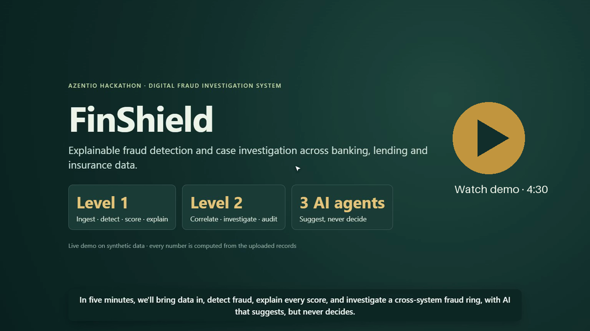

# FinShield

FinShield is our **Digital Fraud Investigation System** for the Azentio.ai hackathon: AI-assisted detection, investigation and case intelligence across banking, lending and insurance data. Every score is explained, every relationship comes from matching identifiers in the data, and every AI output is a suggestion an analyst can accept or reject.

Judges' brief: `Docs/FinShield_Judges_Brief.pdf` · Stage 1 deck: `Docs/FinShield_Stage1_Presentation.html`

## Demo video (4:30)

[](https://github.com/mansh7763/Azentio/raw/main/Docs/FinShield_Demo_Video.mp4)

Click the image to play `Docs/FinShield_Demo_Video.mp4`: a live walkthrough on a fresh database with AI voice-over and captions, covering upload and validation, detection, explainable scores, prioritised and consolidated cases, analyst actions, Ask FinShield, split, the relationship network and Pattern Scout.

## What it does

**Level 1 — detect, analyse and flag**
- Upload CSV, Excel or JSON (customers/accounts, transactions, logins, loan applications, claims). Rows are validated; rejected rows show the row, field and reason; nothing is dropped silently.
- Explainable rule engine on per-customer baselines (only earlier events are used): suspicious transfers, shared devices, failed-login takeover chains, loan applications, loan-to-mule cash-out, structuring, slow drain, dormant accounts, payment convergence and circular flows. Legitimate lookalikes (regular payees, salary, households) are kept low.
- 0–100 risk score with Low / Medium / High bands; the score's contribution lines sum exactly to it, including what lowered the risk.
- Dashboard with the six filters, alert evidence, and an immutable alert store with a case queue.

**Level 2 — investigate, correlate and manage**
- **Cross-system correlation:** alerts are grouped into one investigation when customers share a device, phone, email or payout account, or concern the same customer within 72 hours. The reason is stored with the case.
- **Relationship view:** network of customers, devices, phones, accounts, applications and claims. Every edge shows the shared identifier and the record IDs; very common nodes (office IPs, large merchants) are not used to link customers.
- **Investigation workspace:** timeline, entities, indicators, evidence, risk and notes. Actions: confirm, false positive (reason required), request information, escalate, recommend hold or extra verification, reclassify, conclude, and split a case. Account-affecting actions stay recommendations.
- **Audit trail and report:** every decision, correction and AI output is an append-only event with user and time; original alerts are never edited. Each case downloads as a structured report.
- **Prioritisation:** risk, financial exposure (per currency), related events and evidence strength. Cases resting on a single fact are marked "needs review" instead of top priority.

## AI agents

| Agent | What it does | Guardrails |
| --- | --- | --- |
| **Pattern Scout** | Finds linked customers and converging payments that no rule alerted on, and proposes a hypothesis and a new rule | Candidates and evidence come from the data; the LLM only words them. Suggestions are saved; approve/dismiss is recorded and never changes rules or scores |
| **Ask FinShield** (top right) | Answers questions about the current screen: dashboard, alert, case or network | Loads the data from the store, checks cited IDs against it, treats record text as data, and says so when the answer is not on screen |
| **Reviewer memory** | Shows earlier reviewers' decisions and notes on a case and on cases sharing its entities | Read from the append-only case history |

The app works fully with the LLM off; agents then fall back to deterministic text. The LLM is Groq (`openai/gpt-oss-120b` by default).

## Run

Python 3.12 and Node 18+.

```sh
python -m venv .venv
.venv/Scripts/python -m pip install -r backend/requirements.txt   # macOS/Linux: .venv/bin/python
git config core.hooksPath .githooks
./run.sh                        # backend on :8000 (Windows PowerShell: ./run.ps1)
```

In a second terminal:

```sh
cd frontend
npm install
npm run dev                     # http://127.0.0.1:5173 (calls /api on :8000)
```

Optional AI: put `GROQ_API_KEY=...` (and optionally `GROQ_MODEL=...`) in a `.env` at the repository root, then restart the backend. Never commit `.env`.

After pulling changes to the case tables, delete `backend/fraud.db`; the app does not migrate existing databases.

## Demo in five steps

1. **Data** screen → *Load demo dataset* (CSV, Excel and JSON files; upload `backend/app/datagen/demo/dirty/transactions_dirty.csv` to see rejected rows).
2. **Run detection** → dashboard counts, bands and filters.
3. **Cases** → the top investigation is the loan ring (device `DEV-RING`, phone `9000000001`, payout account `A-C011`, plus an insurance claim paid into it), with the grouping reason and priority.
4. Open it → network view, timeline, evidence; take actions, split an alert out, download the report.
5. Ask FinShield a question about the screen; run Pattern Scout and approve or dismiss a suggestion.

## Key API

| Area | Endpoints |
| --- | --- |
| Data | `POST /api/ingest`, `POST /api/demo/load`, `GET /api/records/{entity}` |
| Detection | `POST /api/detect/run` (a `rules` body is a what-if, not saved), `GET/PUT /api/rules` |
| Alerts and cases | `GET /api/alerts`, `GET /api/cases`, `GET /api/cases/{id}`, `POST /api/cases/{id}/actions`, `POST /api/cases/{id}/split`, `GET /api/cases/{id}/report`, `GET /api/cases/history` |
| Level 2 | `GET /api/incidents`, `GET /api/graph?entity_id=`, `GET /api/graph/groups`, `GET /api/graph/entity/{id}`, `GET /api/priority` |
| Agents | `POST /api/agents/pattern-scout`, `GET /api/agents/suggestions`, `POST /api/agents/suggestions/{id}/decision`, `POST /api/assistant`, `GET /api/assistant/memory` |

Full interactive docs at `http://127.0.0.1:8000/docs`.

## Tests

From `backend/`: `../.venv/Scripts/python -m pytest -q`. The suite includes hand-built golden scenarios with legitimate twins, boundary, evasion, data-edge and metamorphic tests, and the Level 2 case flow. The golden scorecard is `python evals/scorecard.py`. These are synthetic calibration scenarios, not a measure of production accuracy.

## Limits (stated honestly)

- All data is synthetic; no real customer data, payments or credentials.
- Reviewer identity is a typed name; there is no login yet.
- No action touches a real account or payment; holds and verification are recommendations.
- Insurance coverage is limited to claims linked through payout accounts.

## Docs

Plans: `Docs/STAGE1_PLAN.md`, `Docs/PHASE2_PLAN.md` · Evaluation: `Docs/EVALUATION.md` · Ownership: `Docs/OWNERSHIP.md` · Frontend: `frontend/README.md`
