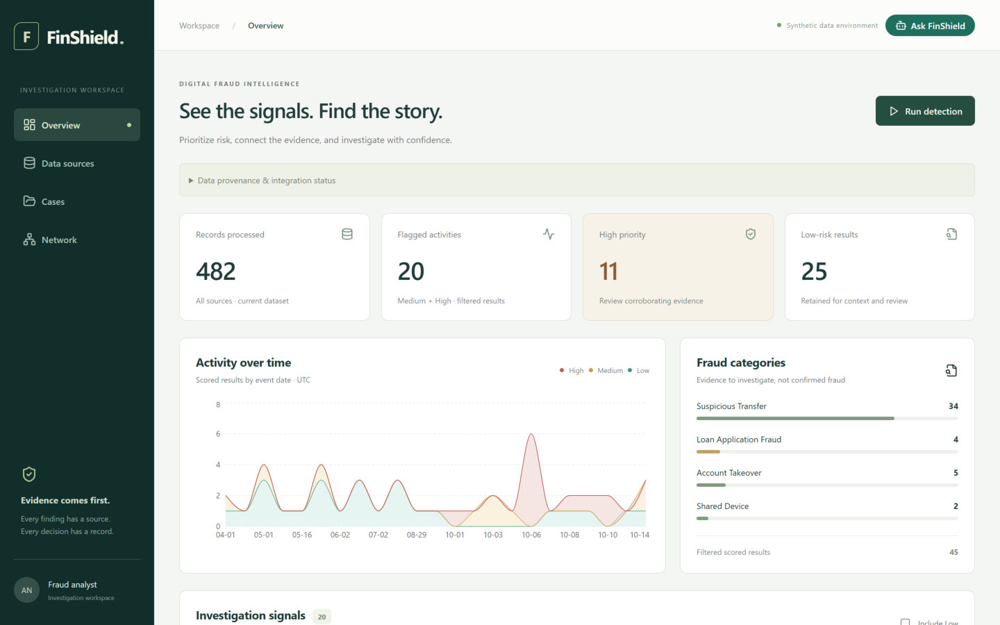
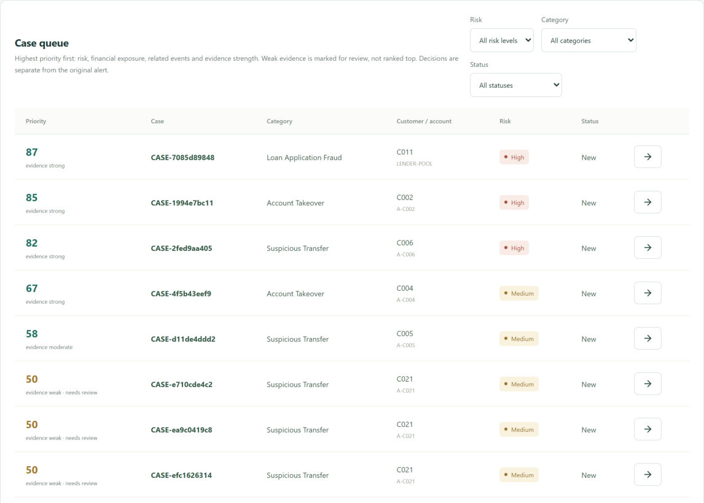
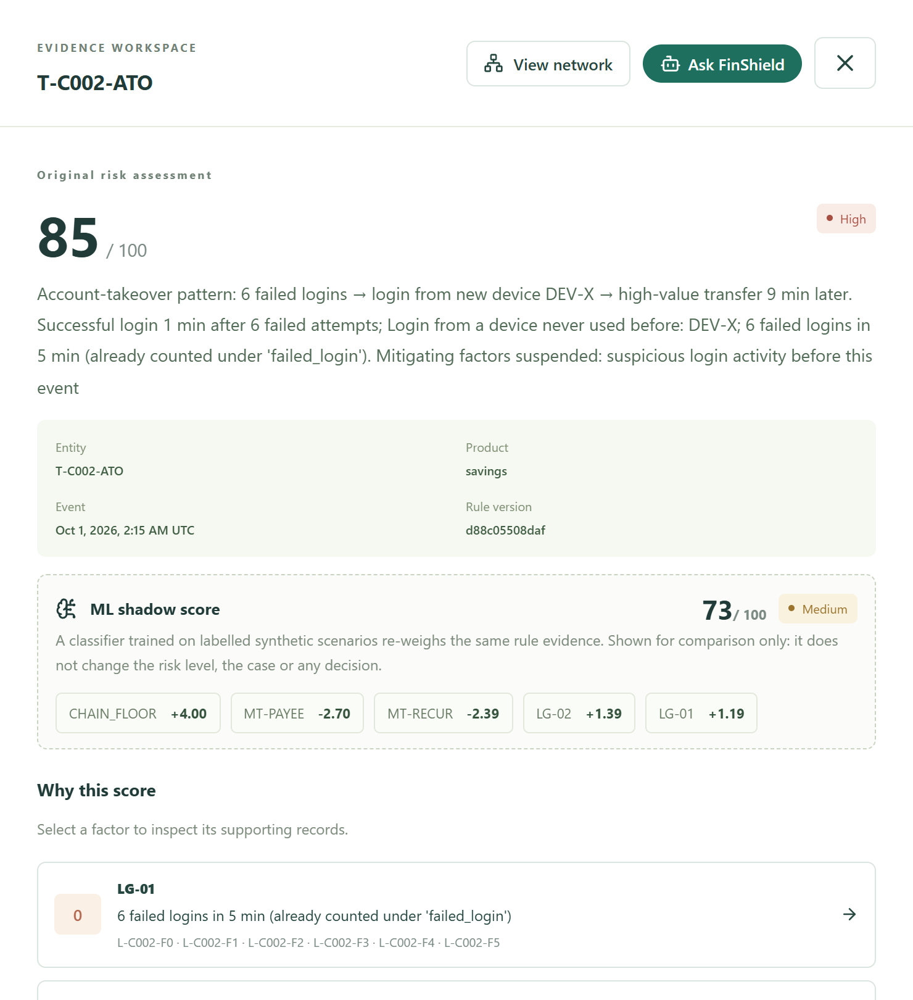
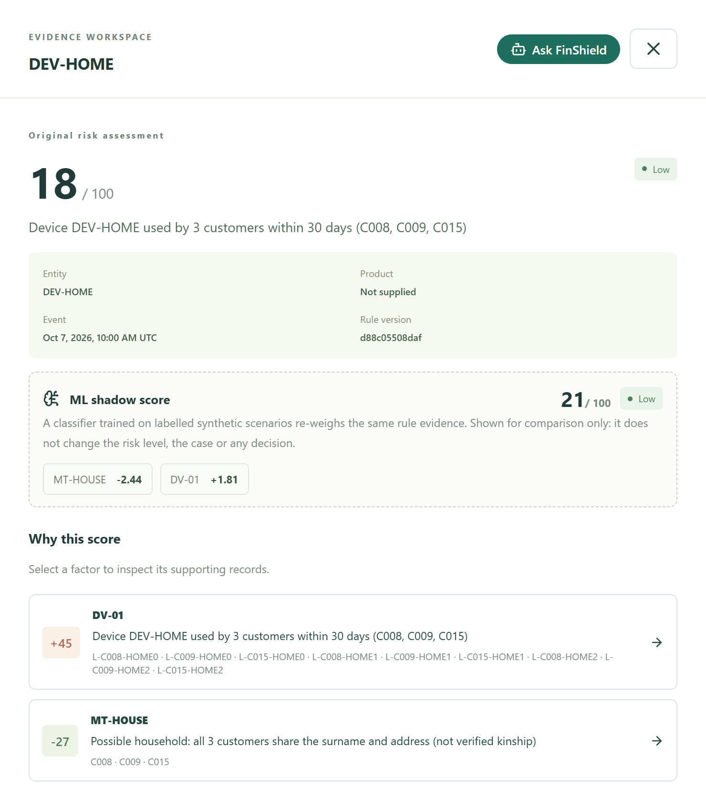
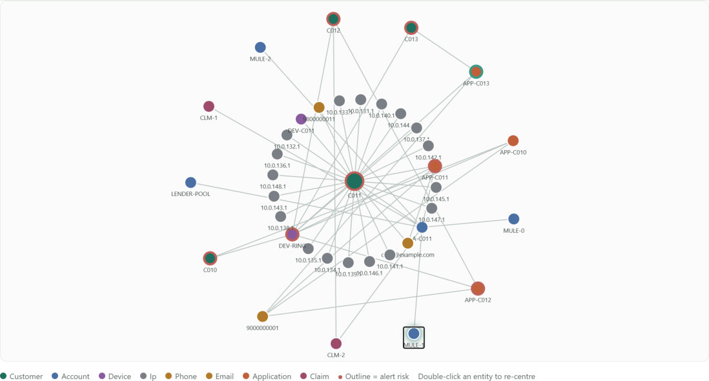
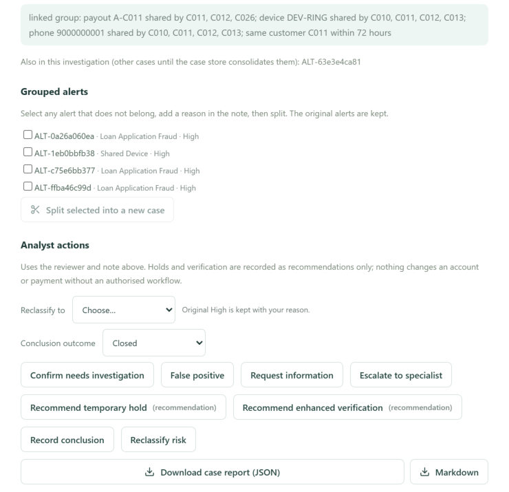
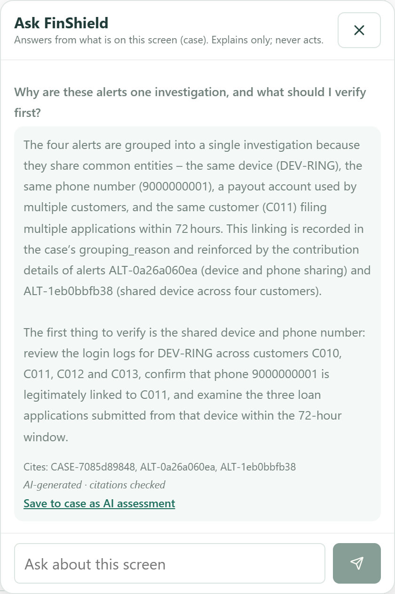
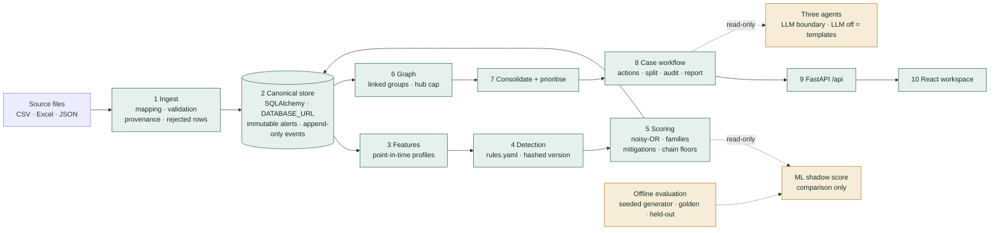

<div align="center">

# FinShield

**Explainable fraud detection and case investigation across banking, lending and insurance data.**

Rules decide · a learned model advises · three AI agents explain and suggest · the analyst owns every decision.

    

Azentio.ai Hackathon · Digital Fraud Investigation System · Level 1 + Level 2

[**Live app**](https://finshield-rho.vercel.app)

[**Submission brief (PDF)**](Docs/FinShield_Submission_Brief.pdf) · [Judges' brief](Docs/FinShield_Judges_Brief.pdf) · [Stage 1 deck](Docs/FinShield_Stage1_Presentation.html)

</div>

---

## Highlights

| 93% | 0% | 0.78 → 0.95 | 34 / 34 |
| :---: | :---: | :---: | :---: |
| of 56 planted fraud incidents caught at Medium or High (held-out data) | of 48 legitimate lookalikes raised to High | ranking quality after learning rule weights (3 unseen datasets) | hand-built calibration scenarios behave as designed |

> All numbers are measured on **synthetic, labelled data** that we never tuned on. They show how the rules behave against scenarios we can simulate, not real-world fraud rates. See [Evaluation](#evaluation) for what we miss.

## Demo video (4:30)

[](https://github.com/mansh7763/Azentio/raw/main/Docs/FinShield_Demo_Video.mp4)

Click the image to play `Docs/FinShield_Demo_Video.mp4`: a live walkthrough on a fresh database with AI voice-over and captions, covering upload and validation, detection, explainable scores, prioritised and consolidated cases, analyst actions, Ask FinShield, split, the relationship network and Pattern Scout.

**Watch on Google Drive:** [FinShield demo video](https://drive.google.com/file/d/12htrC4Xv4CAtlDFEFj4mSNbBtaYrdr5l/view?usp=sharing)

## See it

<table>
<tr>
<td width="50%"><br/><sub><b>Overview.</b> Live counts, activity over time, categories and the six filters, all computed from the stored records.</sub></td>
<td width="50%"><br/><sub><b>Case queue.</b> Sorted by priority with evidence strength; weak evidence is marked "needs review" instead of top priority.</sub></td>
</tr>
<tr>
<td><br/><sub><b>Account takeover · High 85.</b> Failed logins, a never-seen device and a large transfer. The ML shadow score sits beside it, labelled comparison-only.</sub></td>
<td><br/><sub><b>Family tablet · Low 18.</b> Three customers share a device (+45) but also a surname and address, so the household mitigation applies (−27).</sub></td>
</tr>
<tr>
<td><br/><sub><b>Relationship network.</b> Every edge is a shared identifier; hover shows the record IDs that prove it.</sub></td>
<td><br/><sub><b>Case workspace.</b> Why alerts were grouped, split, analyst actions with a reviewer and note, report download.</sub></td>
</tr>
<tr>
<td colspan="2" align="center"><br/><sub><b>Ask FinShield.</b> Answers about the current screen; every cited ID is checked against the data and the answer can be saved to the case as a labelled AI assessment.</sub></td>
</tr>
</table>

## Design principles

| Principle | What it means in the code |
| --- | --- |
| **Rules decide** | 23 active risk indicators, 6 mitigations and 4 attack-chain floors in one versioned file (`backend/app/detect/rules.yaml`) produce every score and band. Same data and rules give the same alerts. |
| **ML advises** | A sign-constrained model learned from labelled scenarios re-weighs the rule evidence. It is shown beside the score and **never** sets a band, case or decision. |
| **Agents explain** | Pattern Scout, Ask FinShield and Reviewer memory suggest and explain. Cited IDs are verified; everything works with the LLM off. |
| **Humans decide** | Eight analyst actions, each with a reviewer and a reason. Holds are recommendations only. Alerts are immutable; every correction is appended. |

Three rules we never broke: **show the why** (every score is named indicators with record IDs, including what lowered it), **nothing silently lost** (rejected rows, unmapped columns and skipped indicators are shown with reasons), and **the record is sacred** (decisions, corrections and AI assessments are appended, never overwritten).

## Architecture



Green is the deterministic decision path, the only place a score, band or case is created. Amber is advisory and has no write path to scores.

### Who may decide what

| Capability | Rules engine | ML shadow | AI agents | Analyst |
| --- | :---: | :---: | :---: | :---: |
| Set the risk score and band | **Decides** | Shown beside it | No | Reclassify only; original kept |
| Open a case from an alert | **Decides** (Medium/High) | No | No | No |
| Group alerts into an investigation | Proposes, with reason | No | No | Can split; split is pinned |
| Change case status, record a decision | No | No | No | **Decides**, with reviewer + note |
| Touch an account or payment | No | No | No | Recommends only |
| Write to the audit trail | System events | No | AI assessment, only when saved by the analyst, labelled | Decisions, actions, corrections |
| Propose a new rule | No | No | Pattern Scout suggests | Approve / dismiss recorded; rules unchanged |

A test (`backend/tests/test_ml_shadow.py`) runs the golden set with and without the ML model and asserts that rule scores, bands and categories are identical.

## What it does

### Level 1: detect, analyse and flag
- **Ingestion.** CSV, Excel and JSON for customers, accounts, transactions, logins, loan applications and claims. Header auto-mapping with manual override, mandatory-field validation, duplicate and conflict reports; rejected rows show the row, field and reason.
- **Detection.** Rules on per-customer baselines (only earlier events are used): suspicious transfers, shared devices, failed-login takeover chains, loan applications, loan-to-mule cash-out, structuring, dormant accounts, payment convergence and circular flows. Legitimate lookalikes (regular payees, salary, households) are kept Low.
- **Scoring.** 0 to 100 with Low / Medium / High. Rules that measure the same fact form a family and only the strongest counts. Contribution lines add up exactly to the score.
- **Dashboard and queue.** Records processed, flagged events, risk distribution, categories, activity over time and the six filters; Medium and High alerts open cases with evidence and status.

### Level 2: investigate, correlate and manage
- **Cross-system correlation.** A loan on a shared device, its payout, unfamiliar recipients and an insurance claim paid into the same account become one investigation.
- **Relationship network.** Customers, devices, phones, accounts, applications and claims. Links come only from matching identifiers (device, phone, email, payout account); very common nodes (office IPs, large merchants) are hidden, not invented.
- **Consolidation.** Alerts group by linked group or same customer within 72 hours, with the reason stored. Wrong groupings can be split; original alerts are kept and splits survive re-runs.
- **Workspace.** Timeline, entities, indicators, evidence, priority and notes; actions: confirm, false positive (reason required), request information, escalate, recommend hold, recommend verification, reclassify, conclude.
- **Audit and report.** Every decision, correction and AI output is an append-only event with user and time. Each case downloads as JSON or Markdown.
- **Prioritisation.** Risk, exposure (per currency, never summed across currencies), related events and evidence strength. Evidence strength is how many independent facts agree, not a probability.

## Trained models: calibrating the weights

We trained classification models to learn how much each existing rule should count, then kept them out of the decision path.

- **Features.** Per scoring unit, each rule's evidence (weight × strength) plus whether an attack-chain floor applied. *Primary parameters* are the risk indicators; *derived parameters* are the mitigations and the chain floor.
- **Model A (selected).** Logistic regression with sign bounds (risk ≥ 0, mitigation ≤ 0) and a pull toward the hand weights. Output: one multiplier per rule.
- **Model B (rejected).** Gradient-boosted trees with monotonic constraints. Higher recall, but lookalike false positives rose to 25% at Medium+ (8% at High).
- **Protocol.** Trained on pooled seeds 2, 6, 7 (3,097 units, 512 fraud); tested on unseen seeds 4, 5, 8 at matched alert volume; 50 bootstrap resamples by incident for 90% intervals.

| Unseen datasets, mean of 3 | Hand weights | Learned weights |
| --- | :---: | :---: |
| Ranking quality (average precision) | 0.78 | **0.95** |
| Precision of Medium+ alerts | 76% | **88%** |
| Background false alarms | 35 | **17** |
| Lookalikes wrongly at Medium+ | 10% | **8%** |
| Fraud incidents caught at Medium+ | 89% | 89% |

Known payee, tenure, new-payee and amount rules deserve more weight than we gave them; network convergence (NW-01, ×0.58) deserves much less. The model ships as `backend/app/detect/ml_model.json` and is shown as a shadow score. Shadow first, promote on evidence.

Reports: `evals/reports/ml_stability.md`, `learned_weights.md`. Retraining needs `scikit-learn` (`python evals/learn_weights.py`); running the app does not.

## AI agents

| Agent | Assists | What it does | Guardrails |
| --- | --- | --- | --- |
| **Pattern Scout** | The system | Finds linked customers and converging payments that no rule alerted on, and proposes a hypothesis and a suggested rule | Deterministic mining finds candidates and record IDs; the LLM only words them. Approve / dismiss needs a note and never changes a rule or score. Decisions survive re-scans |
| **Ask FinShield** | Analyst and evaluator | Answers questions about the current screen (dashboard, alert, case, network): why a case is High, what links these customers | The browser sends the route and IDs only; the backend loads the data. Cited IDs must exist, otherwise they are dropped and shown as dropped. Record text is data, not instructions |
| **Reviewer memory** | Continuity | Brings earlier reviewers' decisions and notes on a case, and on cases sharing its customer or account, into the investigation | Reads the append-only case history; passed to Ask FinShield as context |

Shared guardrails: never decide · real IDs only · data, not orders · labelled and rejectable · works with AI off. LLM: Groq, `openai/gpt-oss-120b` by default.

## Evaluation

Held-out dataset D3 (seed 3, never used for tuning), rules version `d88c05508daf`:

| Measure | Result |
| --- | --- |
| Fraud incidents caught at Medium or High | **93%** of 56 |
| Fraud incidents caught at High | 57% |
| Lookalikes raised to Medium or High / to High | 8% / **0%** of 48 |
| Recall on brand-new customers (cold start) | 100% of 16 |
| Medium/High alerts per 1,000 events | 9.5 |

**What we miss.** Slow drain (small amounts over a long time) stays below Medium: 0 of 4. All 4 lookalike false positives are one scenario (`loan_paid_to_supplier`, Medium, never High). Precision of Medium/High alerts is 50% on this set, counted per alert; the learned-weights table counts per scoring unit on other seeds, so the two are not directly comparable.

Sources: `evals/reports/d3_heldout.md`, `golden_scorecard.md`, `ml_stability.md`. The 34-scenario golden scorecard is regenerated by `python evals/scorecard.py`.

## Scalability and risk controls

**Built and measured**
- 6× faster detection with identical output: 123 s → 19 s on 17k transactions and 11k logins (quadratic hot spots removed).
- Idempotent runs: the run ID is derived from data and rules, so re-running the same inputs reuses the stored run.
- Stable incident keys: a case follows the same incident across runs; pinned splits are never undone.
- Rules are versioned config; a change creates a new version and old alerts stay as history.
- Alerts and audit events are protected by database triggers that refuse UPDATE and DELETE (SQLite and Postgres).
- Pagination on lists; storage chosen by `DATABASE_URL`; hub nodes, assistant context and LLM calls are bounded.

**Deployment.** Hosted Postgres URLs are accepted and the immutability triggers exist for Postgres, with a Render blueprint (`render.yaml`) for the API; we have not load-tested Postgres.

**Production path (designed, not built).** Background workers per tenant and window, streaming ingestion, login with roles and four-eyes approval, an analyst feedback loop that retrains the shadow model, and a rule editor for approved Pattern Scout suggestions. Not yet tested: multi-user concurrency, volumes beyond the synthetic sets.

| Risk | Mitigation |
| --- | --- |
| LLM invents an ID or entity | Citations checked against loaded data; unverifiable IDs dropped and shown |
| Instructions hidden in record text | Record text is data; the model has no tools and no write path |
| LLM down or slow | Time-limited calls; templates and quoted evidence take over |
| Model overreach | ML is shadow-only; test asserts identical rule output with and without it |
| Double counting one fact | Indicator families: only the strongest counts |
| False links from popular IDs | Hub cap; only device, phone, email and payout account group customers |
| Rule drift hides history | Rules hashed to a version; old alerts stay as snapshots |
| Wrongful account action | Holds and verification are recorded recommendations, never executed |
| Re-run undoes a split | Split incidents are pinned |
| Mixed currencies summed | Exposure kept per currency |
| Weak evidence ranked first | Single-fact cases capped below top and marked needs review |
| Tampering with alerts or the audit trail | Database triggers refuse UPDATE and DELETE on alerts and case events |
| Tuning on the data we report | Reported on seeds never used for tuning |

## Run it

Python 3.12 and Node 18+.

```sh
python -m venv .venv
.venv/Scripts/python -m pip install -r backend/requirements.txt   # macOS/Linux: .venv/bin/python
git config core.hooksPath .githooks
./run.sh                        # backend on :8000 (Windows PowerShell: ./run.ps1)
```

In a second terminal:

```sh
cd frontend
npm install
npm run dev                     # http://127.0.0.1:5173 (calls /api on :8000)
```

Optional AI: copy `.env.example` to `.env` at the repository root, set `GROQ_API_KEY` (and optionally `GROQ_MODEL`), then restart the backend. Never commit `.env`. After pulling changes to the case tables, delete `backend/fraud.db`; the app does not migrate existing databases.

### Demo in five steps
1. **Data sources** → *Load demo dataset* (CSV, Excel and JSON; upload `backend/app/datagen/demo/dirty/transactions_dirty.csv` to see rejected rows).
2. **Run detection** → dashboard counts, bands and filters. Open `T-C002-ATO` (High 85); include Low and open `DEV-HOME` (Low 18).
3. **Cases** → the top investigation is the C011 loan ring (device `DEV-RING`, phone `9000000001`, payout account `A-C011`, plus insurance claims paid into it) with its grouping reason and priority.
4. Open it → network, timeline and evidence; take actions, split an alert out, download the report.
5. **Network** → *Run Pattern Scout* and approve one suggestion with a note; ask FinShield "What links these customers?" and save the answer to the case.

### Tests

```sh
cd backend && ../.venv/Scripts/python -m pytest -q      # 399 tests
```

Hand-built golden scenarios with legitimate twins, boundary, evasion, data-edge and metamorphic suites, the Level 2 case flow, and the ML shadow boundary test. These are synthetic calibration scenarios, not a measure of production accuracy.

## API

Interactive docs at `http://127.0.0.1:8000/docs`.

| Area | Endpoints |
| --- | --- |
| Data | `POST /api/ingest`, `POST /api/demo/load`, `GET /api/records/{entity}` |
| Detection | `POST /api/detect/run` (a `rules` body is a what-if, not saved), `GET/PUT /api/rules` |
| Alerts and cases | `GET /api/alerts`, `GET /api/cases`, `GET /api/cases/{id}`, `POST /api/cases/{id}/actions`, `POST /api/cases/{id}/split`, `GET /api/cases/{id}/report`, `GET /api/cases/history` |
| Level 2 | `GET /api/incidents`, `GET /api/graph?entity_id=`, `GET /api/graph/groups`, `GET /api/graph/entity/{id}`, `GET /api/priority` |
| Agents | `POST /api/agents/pattern-scout`, `GET /api/agents/suggestions`, `POST /api/agents/suggestions/{id}/decision`, `POST /api/assistant`, `GET /api/assistant/memory` |

## Repository layout

```
backend/app/
  ingest/    parsers, header mapping, validation, provenance store
  features/  point-in-time customer profiles
  detect/    rules.yaml, indicators, engine, ML shadow score
  score/     noisy-OR scoring, families, chains, explanations
  graph/     relationship graph, linked groups, consolidation, priority, Pattern Scout
  ai/        Ask FinShield and reviewer memory
  api/       alerts, cases, records, dashboard
frontend/    React + TypeScript investigation workspace
evals/       seeded generator, scorecards, held-out reports, weight learning
Docs/        plans, evaluation framework, submission brief, screenshots
scripts/     overlap check, Stage 1 deck and submission brief builders
```

## Limits

- All data is synthetic; no real customer data, payments or credentials.
- Reviewer identity is a typed name; there is no login or role-based approval yet.
- No action touches a real account or payment; holds and verification are recommendations.
- Slow-drain fraud is not caught at Medium.
- AI wording depends on the LLM service; with it off, the app falls back to quoted evidence.
- Learned weights are calibrated on synthetic scenarios and shown only as a shadow score.

## Team

Workstream A: Harsh (data platform, cases, API) · B: mansh7763 (detection, graph, risk) · C: Bhuvan (investigation UI, AI).

## More documentation

Submission brief: [`Docs/FinShield_Submission_Brief.pdf`](Docs/FinShield_Submission_Brief.pdf) (rebuild with `python scripts/submission_brief/build.py`) · Plans: [`Docs/STAGE1_PLAN.md`](Docs/STAGE1_PLAN.md), [`Docs/PHASE2_PLAN.md`](Docs/PHASE2_PLAN.md) · Evaluation framework: [`Docs/EVALUATION.md`](Docs/EVALUATION.md) · Ownership: [`Docs/OWNERSHIP.md`](Docs/OWNERSHIP.md) · Frontend: [`frontend/README.md`](frontend/README.md)
